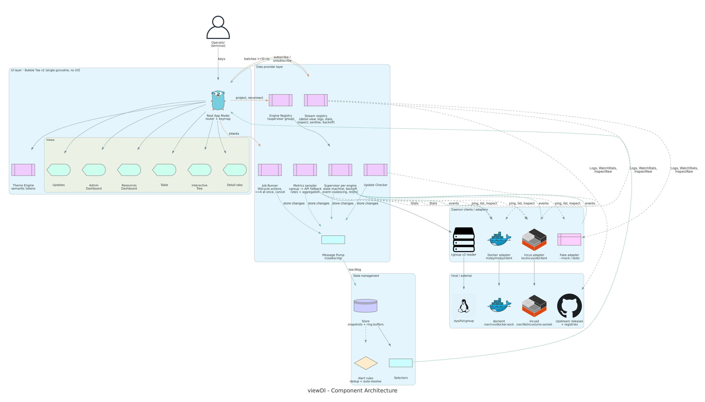
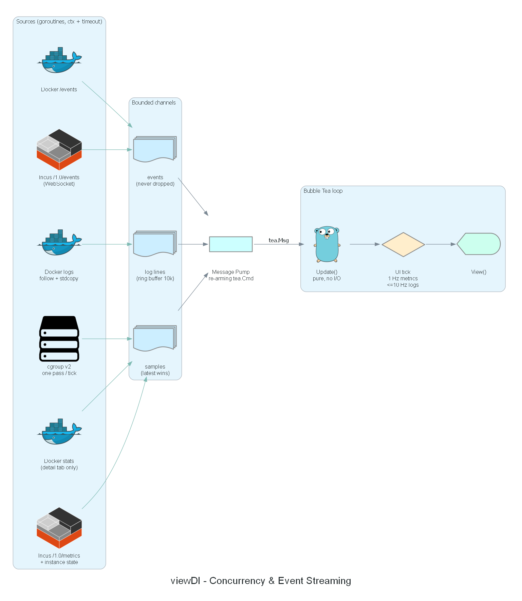
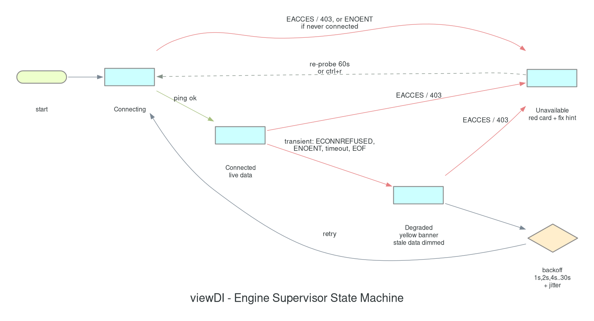
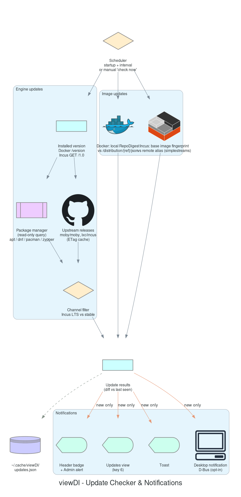

# viewDI — Architecture

Status: **Validated (Phase 1)** · Date: 2026-10-28

All diagrams in this document are generated from code with the Python
[`diagrams`](https://diagrams.mingrammer.com/) package — source:
`docs/diagrams/generate.py`, regenerate with `make docs-diagrams`. Never edit the PNGs by hand.

## 1. Component Architecture



Layers, top to bottom:

| Layer | Responsibility | Packages |
|---|---|---|
| **UI** | Bubble Tea v2 root model, router, keymap, views, components, theme. Single goroutine; pure `Update`/`View`, no I/O. | `internal/app`, `internal/ui/**` |
| **State management** | Store with instance index, networks, metric ring buffers, aggregated totals, alerts (rules in `internal/alerts`), recent events, jobs, update results, engine health. Views read snapshots through selectors. | `internal/store`, `internal/alerts` |
| **Data provider** | Engine registry, supervisor (health/backoff), metrics sampler (cgroup → API fallback), job runner, update checker, message pump. | `internal/supervisor`, `internal/metrics/**`, `internal/jobs`, `internal/updates`, `internal/app` (pump) |
| **Daemon clients** | Docker adapter, Incus adapter, fake adapter, cgroup v2 reader. | `internal/provider/*`, `internal/metrics/cgroup` |
| **Host / external** | `dockerd`, `incusd`, `/sys/fs/cgroup`, upstream release feeds and registries. | — |

Dependency rule: arrows only point **down** at compile time. `ui` imports `store` and
`engine` (types only); it never imports `provider/docker` or `provider/incus`. Wiring
happens in `cmd/viewdi`.

## 2. Concurrency Model



See `01-research.md` §3.2 for the full strategy (event-driven listings, hybrid metric
sampling, bounded channels, timeouts, backpressure).

## 3. Engine Abstraction (capabilities)

Each adapter implements the same capability set. Expressed here as a contract table
(the Go interface lives in `internal/engine`; Stage 1 implements the read-only subset).

| Capability | Docker mapping | Incus mapping |
|---|---|---|
| `Ping` / `Info` | `/_ping`, `/info`, `/version` | `GET /1.0` |
| `ListInstances` | `ContainerList(all)` | `GetInstancesFull` (per project) |
| `Inspect` | `ContainerInspect` | `GetInstance` + `GetInstanceState` |
| `Act(start/stop/restart/pause/unpause)` | container endpoints (409 → conflict) | state check, then `UpdateInstanceState` + `/operations/{id}/wait` |
| `Delete(opts)` | `ContainerRemove` (force, anonymous volumes) | state check, optional stop, `DeleteInstance` + wait |
| `Create(spec)` | `ContainerCreate` + `ContainerStart` | `CreateInstance` + start |
| `Import(source)` | `ImageLoad` / `ImageImport` | `CreateInstanceFromBackup` / image import |
| `InspectRaw` | `ContainerInspect` raw JSON | `GetInstanceFull` |
| `Logs(opts)` | `ContainerLogs(follow, timestamps)` + frame demux | console log + `lxc.log`/`qemu.log`, polled and diffed |
| `WatchStats(interval)` | `ContainerStats(stream=true)` | `GetInstanceState` poll |
| `Events(stream)` | `Events` | `GetEvents` (lifecycle, operation) |
| `Networks / Volumes` | `NetworkList`, `VolumeList` | networks, storage pools/volumes, profiles |
| `EngineVersion` | `/version` | `GET /1.0` `server_version` |
| `ImageUpdateStatus(ref)` | `DistributionInspect` digest vs local `RepoDigests` | `volatile.base_image` vs remote alias fingerprint |
| `Capabilities()` | full (or read-only flag) | derived from socket type / project restrictions |

Domain types (engine-agnostic): `EngineID`, `Instance` (id, name, engine, kind
container|vm, state, image, created, labels, networks, mounts, `Extra`), `Network`,
`Volume`, `Sample` (cpu%, mem used/limit, net rx/tx bytes/s, blk r/w bytes/s, ts),
`LogLine` (ts, stream, text), `Event`, `Job`, `UpdateInfo` (subject engine|image,
current, available, severity, source, notes URL).

## 4. Runtime Flows

### 4.1 Startup
1. Load config (XDG) → resolve theme → resolve sockets.
2. Start UI immediately with skeleton/"connecting…" state (never wait for daemons).
3. Supervisors connect to each engine in parallel; on success: full list + start event
   stream + start aggregate sampler.
4. Update checker schedules its first run 30 s after startup (if enabled).

### 4.2 Supervisor state machine (per engine)



Transitions:
- `Connecting` → `Connected` on a successful ping + initial list.
- `Connecting` / `Connected` / `Degraded` → `Unavailable` on a **permission** error
  (`EACCES`, HTTP 403), including permissions revoked while connected.
- `Connecting` → `Unavailable` on `ENOENT` **only if the engine has never connected** in
  this session (daemon not installed or not started) — the hint names the socket path.
- `Connected` → `Degraded` on any **transient** error: `ECONNREFUSED`, `ENOENT` (socket
  removed by a stopped daemon), request timeout, ping watchdog, stream EOF.
- `Degraded` → backoff (1 s, 2 s, 4 s … capped at 30 s, with jitter) → `Connecting`.
- `Unavailable` → `Connecting` on the slow re-probe (60 s) or `ctrl+r`.

UI mapping: `Degraded` → yellow reconnect banner with countdown, last-known data shown
dimmed and marked stale; `Unavailable` → red engine card with fix hint; the other engine
is unaffected.

### 4.3 Detail view streams
Opening the Detail view runs `Subscribe(instance, {logs, stats, inspect})` in a
`tea.Cmd`; the stream registry (`internal/streams`) starts one goroutine per stream
with a cancellable context. The app reads batches with a re-arming `Next()` command
(at most 10 per second); `esc`, a view key or quitting closes the subscription →
context cancelled → goroutines exit (`goleak`, 100 open/close cycles in CI). A
subscription that arrives after its view closed is closed at once.

Each stream reconnects with backoff after a daemon failure and resumes from the last
log timestamp without duplicates; not-found and permission errors stop it; after a
clean end (instance stopped) it waits for `Refresh`, which the app sends when the
instance's state or its engine's connection changes. Log lines are sanitised in the
registry (terminal escapes, controls, bidi overrides) and at most 5 000 wait for the
UI; older ones are dropped and counted ("dropped N" in the Logs tab).

### 4.4 Lifecycle actions
An action key submits one job per target to the job runner (`internal/jobs`) inside a
`tea.Cmd`; several targets ask for confirmation first, delete always opens its dialog.
Jobs run with their own context and timeout (grace period + 30 s), at most four at once;
their state changes reach the app through a re-arming `Next()` command and land in the
store, which marks the instance pending ("… stopping"). A succeeded job keeps the mark
until the engine's events show the expected state (or a new start time after restart);
after 10 s without confirmation the app warns and resyncs. A failed or canceled job
clears the mark and toasts the daemon's reason. Actions already in effect succeed;
states that forbid an action are reported as conflicts.

### 4.5 Update checker



- Runs as a background job with its own context; network failures are logged and shown
  as "last check failed" in the Updates view, never as a blocking error.
- Produces `UpdatesFoundMsg` containing only the **diff vs the last seen set**; the store
  keeps the full set. Notifications fire only on the diff.
- Package-manager queries run as read-only subprocesses with a 20 s timeout and
  `LC_ALL=C` for stable parsing; nothing is ever executed with elevated privileges.

### 4.6 Rendering & throttling
- UI tick: metrics redraw at a configurable rate (default 1 Hz, max 4 Hz); logs redraw
  coalesced to ≤ 10 Hz regardless of line rate.
- Views render only what is visible (table and tree virtualisation, viewport for logs).
- When the terminal is unfocused (focus reporting) or the dashboard is not visible,
  aggregate sampling drops to a low rate (default 5 s).

## 5. Interactive Tree View — Interaction Model

The Tree view is a **navigable tree**, not a static render: a cursor moves node by node
and a context-sensitive inspector panel on the right always describes the focused node.

### 5.1 Node model

```
Root
└── Engine            (Docker | Incus)               — daemon summary
    └── Group         (Network | Project | Compose project | Profile; chosen with `g`)
        └── Instance  (container | VM)               — live info + sparklines
            └── Leaf  (port | mount/volume | extra network | device)
```

- Every node has a stable ID (`engine/group/instance/leaf`), so the cursor and expansion
  state survive live refreshes (an instance moving state does not reset the tree).
- An instance attached to several networks appears under each network; secondary
  occurrences are marked `⇄` and `J` jumps between occurrences.
- Expansion state per grouping mode is persisted in `state.json`.

### 5.2 Navigation

| Key | Action |
|---|---|
| `↑` / `↓` (`k` / `j`) | Previous / next visible node |
| `→` (`l`) | Expand node; if already expanded, move to its first child |
| `←` (`h`) | Collapse node; if already collapsed (or a leaf), move to its parent |
| `[` / `]` | Previous / next sibling (skips the subtree) |
| `space` | Toggle expand/collapse |
| `*` / `-` | Expand all below cursor / collapse all |
| `Home` / `End`, `PgUp` / `PgDn` | Jump |
| `enter` | Open detail view (instance) or inspector focus (other nodes) |
| `J` | Jump to the next occurrence of the same instance (multi-network) |
| `g` | Cycle grouping: network → project → compose → engine only |
| `/` | Filter: matching nodes stay visible together with their ancestors |
| `ctrl+n` / `ctrl+p` | Next / previous filter match |
| `s` `x` `R` `F` `d` | Lifecycle actions on the focused instance (same as Table) |

Key scoping and the reserved global keys are defined in `03-mockups.md` (Key map).

### 5.3 Inspector panel
- Content depends on node type: engine (daemon status, counts, update badge), network
  (driver, subnet, gateway, attached instances, managed/unmanaged), instance (state,
  image, IPs, ports, mounts, CPU/MEM sparklines), leaf (port mapping / mount details).
- Reads only store snapshots — moving the cursor never triggers daemon I/O. The metrics
  shown come from the aggregate sampler already running.
- Updates are debounced (≈80 ms) so holding `↓` scrolls smoothly.
- A breadcrumb above the tree shows the cursor path: `Docker › web_default › web-api`.

## 6. Theme Engine

Themes are TOML palettes mapped to **semantic tokens**; components only reference
tokens, never raw colors.

| Token group | Tokens |
|---|---|
| Base | `bg`, `bg_alt`, `fg`, `fg_muted`, `border`, `border_focus`, `selection_bg`, `selection_fg` |
| Accent | `accent`, `accent_alt` |
| Status | `ok` (running), `warn` (paused/degraded), `err` (exited/error), `info`, `update` |
| Engines | `engine_docker`, `engine_incus` |
| Tree | `tree_guide` (branch lines), `tree_cursor_bg`, `tree_group` |
| Charts | `chart_cpu`, `chart_mem`, `chart_net_rx`, `chart_net_tx`, `chart_disk` |

Theme switching is a single `ThemeChanged` message: styles are rebuilt once and cached;
no per-frame style construction. Terminals without truecolor degrade automatically
(Lip Gloss color profile detection).

## 7. Error Handling Principles
- Errors are values that reach the UI as messages (`EngineError`, `JobFailed`), shown as
  toast (transient) or banner (persistent). No `panic` in providers; a top-level recover
  in each goroutine reports and restarts via the supervisor.
- Panic in the UI restores the terminal before exiting (Bubble Tea default) and writes the
  stack trace to the debug log.
