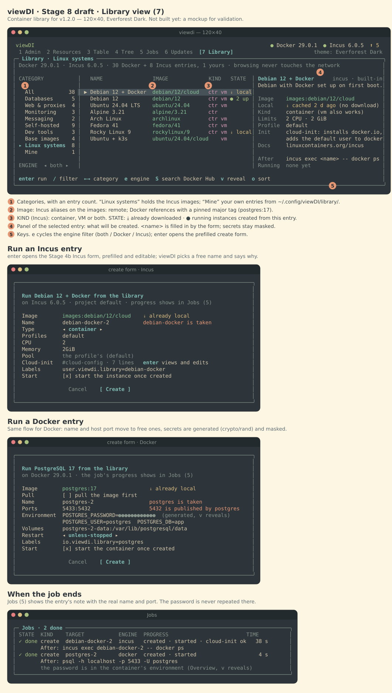

# viewDI — TUI Mockups (structural proposal)

Status: **Validated (Phase 1)**, key map revised 2026-10-28 · Target minimum terminal size: 100×30 (responsive down to 80×24).

Global layout: header (engine status + view tabs) · body · status/key-hint bar.

## Key map

### Scoping rules

Keys resolve through four layers, first match wins:

1. **Modal / text input** (forms, filter prompt, confirm modal): captures every printable
   key; only `esc`, `enter`, `tab`/`shift+tab` and `ctrl+c` keep their meaning.
2. **Component** (log viewer, tree, inspector…).
3. **View** (Table, Tree, Updates, Detail…).
4. **Global**.

Keys in the **reserved** set below must never be rebound by a view or component (layers
2–3); the Stage 0 conflict detector rejects such bindings, both in built-in key maps and
in `keys.toml`. Every other key is free for local use, so the same letter may mean
different things in different views (e.g. `p` = pause in Logs, pull in Updates) as long
as it is not reserved.

### Global keys (reserved)

| Key | Action | Key | Action |
|---|---|---|---|
| `1`–`6` | Admin / Resources / Table / Tree / Jobs / Updates | `enter` | Open detail / confirm |
| `tab` / `shift+tab` | Next / prev tab or pane | `esc` | Back / close modal |
| `/` | Filter (current view) | `e` | Cycle engine filter (all/docker/incus) |
| `n` | Create a container / VM (form) | `i` | Import an image or backup |
| `U` | Check for updates now | `P` | Incus project selector |
| `T` | Theme picker | `?` | Help overlay |
| `ctrl+r` | Force reconnect/resync | `ctrl+d` | Debug overlay (`--debug` only) |
| `ctrl+z` | Suspend (restore terminal; `fg` resumes) | `q` / `ctrl+c` | Quit (`ctrl+c` works even inside modals) |

### Instance action keys (reserved in every view that shows instances: Admin, Table, Tree, Detail)

| Key | Action | Key | Action |
|---|---|---|---|
| `s` | Start | `x` | Stop |
| `R` | Restart | `d` | Delete (confirm) |
| `F` | Pause ↔ unpause (Docker pause / Incus freeze) | `b` | Open in the browser (best address) |
| `B` | Choose the address to open | | |

Actions apply to the rows marked with `space` in the Table, else to the instance under the
cursor (or the one a Detail view shows). Several targets ask for confirmation; delete always
opens the delete dialog (focus on Cancel, options unticked, name typed for running or
volume-backed instances). Rows show the operation in flight (`… stopping`) until the engine
confirms it. `--read-only` and restricted engines disable the keys and say why (except `b` and `B`,
which change nothing).

`b` opens the instance under the cursor in the default browser: the port it publishes on the host
(`http://localhost:8080`, `https` for 443/8443/9443) if it has one, else its first address. `B`
lists every choice (each address with `http` and `https`). Only private, loopback, link-local and
CGNAT IPv4 addresses and `localhost` are ever opened. A VM that reports no address (no
`incus-agent`) gets it from the DHCP leases of its bridge when the network is managed by Incus.

### Common local keys

| Key | Where | Action |
|---|---|---|
| `o` / `O` | Table, Resources (Top consumers), Updates | Cycle sort column / reverse order |
| `space` | Table | Mark row (multi-select) |
| `space`, `*`, `-`, `[`, `]`, `J`, `g`, `L` | Tree | See `02-architecture.md` §5.2 |
| `ctrl+n` / `ctrl+p` | Tree, Logs, Inspect (while a filter is active) | Next / previous match |
| `p`, `w`, `t`, `S`, `G`, `gg` | Logs tab | Pause, wrap, timestamps, stream (all → stdout → stderr → system), end, top |
| `v` | Overview tab | Reveal the masked env value under the cursor |
| `tab` / `shift+tab`, `esc` | Detail | Next / previous tab, back (after clearing a filter) |
| `↑↓`/`jk`, `pgup`/`pgdown`, `home`/`end` | Detail tabs | Scroll / move the cursor |
| `→`/`l`, `←`/`h`, `space`, `*`, `y`, `enter` | Inspect tab | Expand, collapse / parent, toggle, expand all, copy path (OSC 52), toggle |
| `+` / `-` | Resources, Resources tab | Refresh rate / time window |
| `p`, `c`, `f`, `z`, `I` | Updates | Pull, recreate, refresh image, snooze, ignore version |
| `↑↓`/`jk`, `home`/`end`, `c` | Jobs | Move, cancel the queued or running job |
| `tab`/`↑↓`, `space`, `enter`, `esc` | Delete dialog | Move, tick an option, press the focused button, cancel |

## M1 — Admin Dashboard (`1`)

```
┌ viewDI ─────────────────────────────────────── ● Docker 29.x  ● Incus 6.x  ⬆ 4 ┐
│ [1 Admin] 2 Resources  3 Table  4 Tree  5 Jobs  6 Updates            theme: Everforest │
├──────────────────────────────────────────────────────────────────────────────────────┤
│ ┌ Docker daemon ───────────────────────┐ ┌ Incus daemon ─────────────────────────────┐│
│ │ Status    ● connected  (rootful)     │ │ Status    ● connected  (incus-admin)      ││
│ │ Version   29.x   API 1.5x            │ │ Version   6.x    project: default         ││
│ │ Containers  12  ▶ 9  ■ 3  ⏸ 0        │ │ Instances    7  ▶ 5 (2 VM)  ■ 2           ││
│ │ Images 34   Volumes 18   Networks 6  │ │ Images 9  Pools 2  Networks 3  Profiles 4 ││
│ │ Storage driver overlay2  cgroup v2   │ │ Storage zfs (pool0), dir (local)          ││
│ └──────────────────────────────────────┘ └───────────────────────────────────────────┘│
│ ┌ Alerts (4) ────────────────────────────────────────────────────────────────────────┐│
│ │ ⬆ incus   engine 6.0.5 → 6.0.6  (LTS · security fix)  — 6 to view                    ││
│ │ ▲ docker  postgres-dev   unhealthy for 4m (healthcheck failing)                    ││
│ │ ▲ incus   k3s-node1      memory 92% of limit (3.7/4.0 GiB)                          ││
│ │ ● docker  nginx-proxy    restarted 3 times in 10m                                   ││
│ └────────────────────────────────────────────────────────────────────────────────────┘│
│ ┌ Shortcuts ─────────────────────────────┐ ┌ Recent events ──────────────────────────┐│
│ │ n  new container    i  import          │ │ 14:02:11 docker start   redis-cache     ││
│ │ 3  all containers   4  network tree    │ │ 14:01:57 incus  stop    test-alpine     ││
│ │ T  change theme     ?  help            │ │ 13:58:03 docker pull    nginx:1.27      ││
│ └────────────────────────────────────────┘ └─────────────────────────────────────────┘│
├──────────────────────────────────────────────────────────────────────────────────────┤
│ ? help  1-6 views  / filter  T theme  q quit                        jobs: 0 running  │
└──────────────────────────────────────────────────────────────────────────────────────┘
```

## M2 — Resources Dashboard (`2`)

```
┌ viewDI ─────────────────────────────────────────────── ● Docker  ◐ Incus (reconnecting 4s) ┐
│ 1 Admin [2 Resources] 3 Table  4 Tree  5 Jobs  6 Updates                       refresh 1s │
├ ⚠ Incus socket not responding — showing data from 14:03:10 · retry in 4s · ctrl+r now ────┤
│ ┌ DOCKER ─────────────────────────────────────┐ ┌ INCUS (stale) ─────────────────────────┐│
│ │ CPU  ███████░░░░░░░░░  38%  ▁▂▃▅▆▅▃▂▃▅▆▇    │ │ CPU  ███░░░░░░░░░░░  17%  ▁▁▂▂▃▂▁▂▂▃   ││
│ │ RAM  ██████████░░░░░░  6.1/16.0 GiB  ▃▃▄▄▅  │ │ RAM  █████░░░░░░░░░  4.9/16.0 GiB ▂▂▃▃ ││
│ │ NET  ↓ 2.4 MB/s  ↑ 310 KB/s   ▁▃▇▅▂▁▂▄      │ │ NET  ↓ 120 KB/s  ↑ 80 KB/s   ▁▁▂▁▁▂    ││
│ │ DISK r 12 MB/s   w 4.1 MB/s   ▂▂▅▃▁▁▂▂      │ │ DISK r 1 MB/s    w 0.3 MB/s  ▁▁▁▂▁▁    ││
│ └─────────────────────────────────────────────┘ └────────────────────────────────────────┘│
│ ┌ Top consumers ─────────────────────────────────────────────────────────────────────────┐│
│ │ ENG    NAME             CPU%   MEM            NET ↓/↑          BLK r/w                 ││
│ │ dock   postgres-dev     21.4   1.2 GiB        40K / 12K        8.0M / 3.1M             ││
│ │ incus  k3s-node1        14.9   3.7 GiB        110K / 70K       0.9M / 0.2M             ││
│ │ dock   nginx-proxy       6.2   48 MiB         2.3M / 290K      0 / 0                   ││
│ └────────────────────────────────────────────────────────────────────────────────────────┘│
├───────────────────────────────────────────────────────────────────────────────────────────┤
│ enter open  o sort  +/- refresh rate  ctrl+r reconnect                                     │
└───────────────────────────────────────────────────────────────────────────────────────────┘
```

## M3 — Table View (`3`)

```
┌ viewDI ──────────────────────────────────────────────────────── ● Docker  ● Incus ┐
│ 1 Admin  2 Resources [3 Table] 4 Tree  5 Jobs  6 Updates  eng: all  filter: /web_   │
├─────────────────────────────────────────────────────────────────────────────────────┤
│   ENG    NAME              KIND  STATE      IP           IMAGE             CPU%  MEM    UP  │
│ ▶ dock   web-frontend      ctr   ● running  node:22-alpine          3.1  210M   2d  │
│   dock   web-api           ctr   ● running  ghcr.io/me/api:1.4      7.8  340M   2d  │
│   dock   web-db            ctr   ▲ unhealthy postgres:17           21.4  1.2G   2d  │
│   incus  web-lab           ctr   ● running  images:debian/12        0.4   88M   6h  │
│   incus  web-win11         vm    ■ stopped  (local) win11            —     —    —   │
│                                                                                     │
│                                                                    5 of 19 shown    │
├─────────────────────────────────────────────────────────────────────────────────────┤
│ enter detail  s start  x stop  R restart  F pause  d delete  n new  e engine  / filter  │
└─────────────────────────────────────────────────────────────────────────────────────┘
```

## M4 — Interactive Tree View (`4`)

A real navigable tree: box-drawing branch guides, a cursor (`▌` + highlighted row) that
moves node by node with the arrow keys, and an inspector on the right that follows the
cursor instantly. Interaction model: `02-architecture.md` §5.

### M4.a — Cursor on a container

```
┌ viewDI ─────────────────────────────────────────────────────────── ● Docker  ● Incus  ⬆ 4 ┐
│ 1 Admin  2 Resources  3 Table [4 Tree] 5 Jobs  6 Updates           group: network (g)     │
├ Docker › web_default › web-api ─────────────────┬─────────────────────────────────────────┤
│  viewDI                                          │ ● web-api                    docker ctr │
│  ├── ▣ Docker 29.x ················· 12 ▶9 ■3    │ ─────────────────────────────────────── │
│  │   ├── ◆ bridge          172.17.0.0/16         │ State    ● running · up 2d 4h           │
│  │   │   └── ● redis-cache                       │ Image    ghcr.io/me/api:1.4  ⬆ 1.5      │
│  │   ├── ◆ web_default     172.20.0.0/16         │ Compose  web / api                      │
│  │   │   ├── ● web-frontend                      │ IPs      web_default  172.20.0.3        │
│ ▌│   │   ├── ● web-api  ⬆  ⇄                    │          monitoring   172.21.0.5        │
│  │   │   │   ├── ⇢ 8080 → 8080/tcp               │ Ports    0.0.0.0:8080 → 8080/tcp        │
│  │   │   │   ├── ▣ ./config → /app/config  ro    │ Mounts   ./config → /app/config (ro)    │
│  │   │   │   └── ⇄ also on: monitoring           │ Health   ● healthy (12s ago)            │
│  │   │   └── ▲ web-db   unhealthy                │                                         │
│  │   └── ◆ monitoring (2) ▸                      │ CPU  7.8%  ▁▂▃▅▃▂▂▃▅▆▅▃                 │
│  └── ▦ Incus 6.0.5 · project default ··· 7 ▶5 ■2 │ MEM  340M/1G ▃▃▄▄▅▅▅▅▅▅▅                │
│      ├── ◆ incusbr0        10.10.0.1/24  managed │ NET  ↓40K ↑12K/s                        │
│      │   ├── ● web-lab                           │                                         │
│      │   └── ● k3s-node1  vm                     │ enter details · s start · x stop        │
│      └── ◆ macvlan0 ▸                            │ R restart · d delete · J next ⇄         │
├──────────────────────────────────────────────────┴─────────────────────────────────────────┤
│ ↑↓ move  ← parent/collapse  → expand/child  [ ] sibling  space toggle  * all  / filter  g group │
└────────────────────────────────────────────────────────────────────────────────────────────┘
```

### M4.b — Cursor on a network (inspector adapts to the node type)

```
├ Incus › incusbr0 ───────────────────────────────┬─────────────────────────────────────────┤
│  ...                                             │ ◆ incusbr0                 incus network│
│  └── ▦ Incus 6.0.5 · project default             │ ─────────────────────────────────────── │
│ ▌    ├── ◆ incusbr0        10.10.0.1/24  managed │ Type     bridge (managed)               │
│      │   ├── ● web-lab                           │ IPv4     10.10.0.1/24  NAT on           │
│      │   └── ● k3s-node1  vm                     │ IPv6     fd42:7a1::1/64                 │
│      └── ◆ macvlan0 ▸                            │ DHCP     on · 2 leases                  │
│                                                  │ Members  web-lab, k3s-node1             │
│                                                  │ Traffic  ↓ 150K/s  ↑ 82K/s  ▁▂▂▃▂▁      │
```

### M4.c — Filter (`/k3s`): matches stay visible with their ancestors

```
│  viewDI                                filter: k3s_  (1 match)  │
│  └── ▦ Incus 6.0.5 · project default                            │
│      └── ◆ incusbr0                                             │
│ ▌        └── ● k3s-node1  vm                                    │
```

### M4.d — Narrow screens (< 100 columns): the inspector moves under the tree

```
╭─ Docker › web_default › web-api ─────────────────────────────────────────────╮
│ ▌│   │   ├── ● web-api  ⇄                                                    │
│  │   │   │   ├── ⇢ 0.0.0.0:8080 → 8080/tcp                                   │
╰──────────────────────────────────────────────────────────────────────────────╯
╭─ Inspector ──────────────────────────────────────────────────────────────────╮
│ ● web-api                                                   docker container │
│ State    ● running · up 2d                                                   │
│ Image    ghcr.io/me/api:1.4                                                  │
│ IP       172.20.0.3 on web_default                                           │
│ CPU  7.3%               ▅▆▆▇▇▇▇█▇▇▇▇▆▆▅▅▄▄▃▃▂▂▂▂▂▃▃▄▄▅                       │
│ MEM  340M/1.0G          ▃▃▃▃▃▃▃▃▃▃▃▃▃▃▃▃▃▃▃▃▃▃▃▃▃▃▃▃▃▃                       │
╰──────────────────────────────────────────────────────────────────────────────╯
```

### M4.e — Lab grouping (`g` until "lab"): declared links drawn as lanes

Labs are blocks of machines from both engines that the user groups and links with `L`.
Each link is a lane to the right of the tree; while both ends run, a dot (`●`, `warn`
token) travels along it, faster with more traffic. The lane of a stopped end is grey and
still; lanes of the machine under the cursor are highlighted.

```
╭─ lab web-stack › nginx-proxy ──────────────────────────────────╮╭─ Inspector ────────────────────────────────────────╮
│  viewDI                        15 machines                     ││ ● nginx-proxy                     docker container │
│  ├── ◈ lab web-stack  6 links · 4 active                       ││ ────────────────────────────────────────────────── │
│  │   ├── ? legacy-vm  missing        incus ───╮                ││ State    ● running · up 3h                         │
│ ▌│   ├── ● nginx-proxy                     ───┼──┬──╮          ││ Image    nginx:1.27                                │
│  │   ├── ■ postgres-dev  stopped           ───┼──┼──┼──╮       ││ IPs      bridge        172.17.0.3                  │
│  │   ├── ● redis-cache                     ───┼──┼──┼──┼──╮    ││ Ports    0.0.0.0:80 → 80/tcp                       │
│  │   ├── ● web-api                         ───┴──┴──┼──┼──┴──╮ ││          0.0.0.0:443 → 443/tcp                     │
│  │   ├── ▲ web-db  unhealthy               ─────────┼──┼─────╯ ││ Labs     web-stack                                 │
│  │   └── ● web-lab                         ─────────┴──╯       ││ Links    ↔ ● web-api · container · docker          │
│  ├── ◈ lab k8s  1 link · 1 active                              ││          ↔ ● web-lab · container · incus           │
│  │   ├── ● dev-arch  [lab]                 ───╮                ││                                                    │
│  │   └── ● k3s-node1  vm                   ───╯                ││ CPU  6.8%               ▅▆▆▇▇▇▇▆▅▄▃▃▂▂▂▃▃▄▅▆▇▇▇▇▆▆ │
│  └── ◇ (not in a lab)  ▸ 7                                     ││ MEM  48.0M              ▅▆▆▇▇▇▆▅▄▄▃▂▂▂▂▃▄▄▅▆▇▇▇▆▆▅ │
╰────────────────────────────────────────────────────────────────╯╰────────────────────────────────────────────────────╯
```

`L` opens the lab menu for the node under the cursor:

```
╭────────────────────────────────────────────────────╮
│  Labs                                              │
│                                                    │
│  ›New lab with nginx-proxy…                        │
│   Add nginx-proxy to a lab…                        │
│   Link nginx-proxy with…             in web-stack  │
│   Remove a link…                     in web-stack  │
│   Remove nginx-proxy from web-stack                │
│   Rename lab web-stack…                            │
│   Delete lab web-stack…                            │
│                                                    │
│  ↑/↓ move · enter select · esc cancel              │
╰────────────────────────────────────────────────────╯
```

Visual rules:
- Branch guides (`├──`, `└──`, `│`) use the `tree_guide` token (muted); the cursor row uses
  `tree_cursor_bg` across the full width of the tree pane, with a `▌` marker.
- Collapsed groups show `▸` plus a child count; status glyphs are those of the Table
  (`●` running, `▲` unhealthy, `⏸` paused, `■` stopped, `○` created) in `ok` / `warn` /
  `err` / muted; an operation in flight adds `… stopping` after the name.
- `⇄` marks a secondary occurrence of a multi-network instance; `[lab]` an Incus instance
  outside the default project; `⬆` (an available image update) arrives with Stage 6.
- Icons: `▣` Docker, `▦` Incus, `◆` group, `◇` catch-all group, `⇢` port, `▤` mount,
  `◈` lab, `?` missing lab member.
  They fall back to ASCII (`[D]`, `[I]`, `#`, `->`, `=`, `*` running, `-` stopped, `|--`
  guides, `[L]` lab, `+` lane joins, `o` dot) with `[ui] ascii_icons = true`, on
  `TERM=linux`, or with a non-UTF-8 locale.
- Lanes use `tree_guide` while idle, muted when idle under the cursor, `tree_group` while
  active and `ok` (bold) when active under the cursor; the dot uses `warn`. The animation
  follows `[tree] animation` / `animation_ms` and is off with `NO_COLOR`.

## M5 — Detail View: tabs

```
┌ viewDI › web-api (docker) ────────────────────────────────────────── ● running  up 2d ┐
│ [Overview] Logs  Inspect  Network  Volumes  Resources                                   │
├─────────────────────────────────────────────────────────────────────────────────────────┤
│ Description   REST API for the web stack                (label: org.opencontainers.     │
│                                                          image.description)             │
│ Image         ghcr.io/me/api:1.4   sha256:9f3c…a1                                       │
│ Command       /app/server --port 8080                                                   │
│ Created       2026-10-26 11:04   Restart policy  unless-stopped   Health ● healthy      │
│ Compose       project web · service api                                                 │
│ Labels        com.docker.compose.project=web   tier=backend   owner=homelab             │
│ Env           PORT=8080  DB_HOST=web-db  DB_PASSWORD=•••••• (v reveal)                  │
├─────────────────────────────────────────────────────────────────────────────────────────┤
│ tab next  s start  x stop  R restart  F pause  d delete  esc back                        │
└─────────────────────────────────────────────────────────────────────────────────────────┘
```

Logs tab:

```
│ Overview [Logs] Inspect  Network  Volumes  Resources        ⏸ PAUSED (+142 new)  filter: /error_ │
├──────────────────────────────────────────────────────────────────────────────────────────┤
│ 14:02:10.331 out  GET /health 200 0.4ms                                                    │
│ 14:02:11.902 err  ERROR db: connection refused (web-db:5432)                               │
│ 14:02:12.004 err  ERROR retrying in 2s                                                     │
│ ...                                                                                        │
├──────────────────────────────────────────────────────────────────────────────────────────┤
│ p pause/resume  / filter (regex)  w wrap  t timestamps  S out/err/all  G end  gg top      │
```

Resources tab:

```
│ Overview  Logs  Inspect  Network  Volumes [Resources]                       window: 5m (+/-) │
├──────────────────────────────────────────────────────────────────────────────────────────┤
│ CPU  7.8%  (limit 2 cpus)        ▁▂▃▂▂▃▅▇▆▅▃▂▂▃▅▆▅▃▂▁▂▃▃▂▂▃▅▆▇█▇▆▅▃                       │
│ MEM  340 MiB / 1 GiB (33%)       ▃▃▃▃▄▄▄▄▄▄▅▅▅▅▅▅▅▅▅▅▅▅▅▅▅▅▅▅▅▅▅▅▅                       │
│ NET  ↓ 40 KB/s  ↑ 12 KB/s        ▁▁▂▁▁▃▁▁▂▁▁▁▂▅▂▁▁▁▂▁▁                                     │
│ BLK  r 0 B/s  w 120 KB/s         ▁▁▁▁▁▁▂▁▁▁▁▁▁▁▁▃▁▁▁▁                                      │
│ PIDS 14                                                                                     │
```

## M6 — Updates View (`6`)

```
┌ viewDI ─────────────────────────────────────────────────────────── ● Docker  ● Incus  ⬆ 4 ┐
│ 1 Admin  2 Resources  3 Table  4 Tree  5 Jobs [6 Updates]     last check 09:12 · U check now │
├────────────────────────────────────────────────────────────────────────────────────────────┤
│ ENGINES                                                                                    │
│   ENG    INSTALLED   AVAILABLE   CHANNEL   SOURCE     SEVERITY      UPGRADE HINT           │
│ ▶ incus  6.0.5       6.0.6       LTS       apt        ⚠ security    sudo apt install --only-upgrade incus │
│   docker 29.1.2      29.1.2      stable    apt        ✓ up to date                         │
│                                                                                            │
│ IMAGES                                                                                     │
│   ENG    INSTANCE(S)              IMAGE                    LOCAL      REMOTE     ACTION    │
│   dock   web-api                  ghcr.io/me/api:1.4       sha…9f3c   sha…a71e   pull/recreate │
│   dock   nginx-proxy              nginx:1.27               sha…11b0   sha…c3d2   pull/recreate │
│   incus  web-lab                  images:debian/12         4f1a…      8be0…      refresh   │
│   dock   web-db (ignored)         postgres:17              —          —          ignored   │
├────────────────────────────────────────────────────────────────────────────────────────────┤
│ enter notes  p pull  c recreate  f refresh  z snooze 7d  I ignore version  U check now     │
└────────────────────────────────────────────────────────────────────────────────────────────┘
```

Toast on newly found updates (bottom-right, auto-dismiss 6 s):

```
                                                   ┌ ⬆ Updates found ───────────────┐
                                                   │ Incus 6.0.6 (security)         │
                                                   │ 2 Docker images · 6 to view    │
                                                   └────────────────────────────────┘
```

As delivered in Stage 6a (`--mock`, 120×40; pull, recreate and refresh arrive in 6b).
Engines come first, then images; `o`/`O` sort, `enter` opens the release notes,
`z` snoozes for 7 days, `I` ignores this version (both toggle back), `U` checks now. The
footer details the selected row: upgrade hint and notes for an engine, full digests and
instances for an image. Below 100 columns SOURCE, RELEASED and INSTANCES are dropped. The
same `⬆` marks the instances in the Table and the Tree, whose inspector shows
`Update ⬆ current → available`; the toast reads "Updates available: Docker 29.1.0,
Incus 6.0.6 (security), 3 images · 6 for details" and is never repeated.

```
 viewDI                                                                             ● Docker 29.0.1  ● Incus 6.0.5  ⬆ 5
  1 Admin  2 Resources  3 Table  4 Tree  5 Jobs  6 Updates                                       theme: Everforest Dark
╭─ Updates · 5 available ──────────────────────────────────────────────────────────────────────────────────────────────╮
│ engines checked 14:04 · images checked 14:04 (13 sources) · U checks now                                             │
│                                                                                                                      │
│   ENGINE   INSTALLED  AVAILABLE    LEVEL     CHANNEL  SOURCE  RELEASED   STATUS                                      │
│ ⬆ Docker   29.0.1     29.1.0       minor     stable   mock    2026-10-22                                             │
│ ⬆ Incus    6.0.5      6.0.6        security  LTS      mock    2026-10-17                                             │
│                                                                                                                      │
│   ENGINE IMAGE                             INSTANCES              CURRENT → AVAILABLE             STATUS             │
│ ⬆ dock   ghcr.io/me/api:1.4                web-api                e710618204df → a1b69359dd33     compose            │
│ ⬆ dock   nginx:1.27                        nginx-proxy            00a214c9e65b → 120f57a4ad65                        │
│ ⬆ incus  images:debian/bookworm/default    web-lab, ci-runner     20261020_05:24 → 20261028_05:24                    │
│                                                                                                                      │
│ upgrade   sudo apt install --only-upgrade incus                                                                      │
│ notes     https://github.com/lxc/incus/releases/tag/v6.0.6  (enter)                                                  │
│ LTS channel: only 6.0.x releases are offered (incus_channel overrides it)                                            │
│                                                                                                                      │
╰──────────────────────────────────────────────────────────────────────────────────────────────────────────────────────╯
```

As delivered in Stage 6b (`--mock`, 120×40, after `p` on `nginx:1.27`). `p` pulls a
Docker image, `f` refreshes an Incus image (the instances keep running on their own
copy until they are rebuilt), `c` recreates the Docker containers on the new build. A
pulled image whose containers still run the old build stays listed as
`pulled · recreate`; once recreated, the image check runs again and the row goes away.
Compose containers are never recreated here: the footer prints the
`docker compose up -d` hint instead.

```
│   ENGINE IMAGE                             INSTANCES              CURRENT → AVAILABLE             STATUS             │
│ ⬆ dock   ghcr.io/me/api:1.4                web-api                e710618204df → a1b69359dd33     compose            │
│ ⬆ dock   nginx:1.27                        nginx-proxy            running → pulled 120f57a4ad65   pulled · recreate  │
│ ⬆ incus  images:debian/bookworm/default    web-lab, ci-runner     20261020_05:24 → 20261028_05:24                    │
│                                                                                                                      │
│ pulled    sha256:120f57a4ad650d5809f2fbf5cbbbd48b76d3b4df5225abf4040860498e25428d                                    │
│ stale     nginx-proxy                                                                                                │
│ actions   c recreate the containers on the pulled build                                                              │
╰──────────────────────────────────────────────────────────────────────────────────────────────────────────────────────╯
 enter release notes  p pull image  f refresh image  c recreate  z snooze  I ignore version                     ? help
```

`c` first shows what is kept, then asks to confirm (80×24 frame). The recreate job pulls,
stops, renames the container `<name>-old`, creates and starts the new one and removes
the old one only once the new one runs; on any failure the old one gets its name back
and is started again (Jobs shows `rolling back`).

```
╭───────────────────────────────────────────────────────────────────╮
│                                                                   │
│  Recreate 1 container on nginx:1.27                               │
│                                                                   │
│  image    nginx:1.27  00a214c9e65b → 120f57a4ad65 (pulled first)  │
│                                                                   │
│  nginx-proxy  kept:                                               │
│    name     nginx-proxy                                           │
│    env      0 variables (values not shown)                        │
│    ports    80→80/tcp, 443→443/tcp                                │
│    mounts   none                                                  │
│    networks bridge                                                │
│    restart  always                                                │
│    labels   0 labels                                              │
│                                                                   │
│  The new build's defaults (CMD, ENV, labels) apply where          │
│  the container never set its own.                                 │
│                                                                   │
│   Cancel    Continue                                              │
│                                                                   │
│  y confirm · n/esc cancel · tab switch                            │
╰───────────────────────────────────────────────────────────────────╯
```

Desktop notifications (opt-in: `[updates] notify_desktop = true`; in `--mock` only with
`--mock-notify`) carry the same diff as the toast, filtered by `notify_min_level`:
"viewDI: 2 updates available", one line per update (at most 8), "Press 6 in viewDI for
details.", critical urgency when one is a security release.

## M7 — Modals

```
┌ Delete container? ──────────────────────────┐   ┌ Theme ───────────────────┐
│ Engine:  docker                             │   │   Everforest Dark        │
│ Name:    web-db                             │   │ ▶ Catppuccin Mocha  ■■■■ │
│ [x] remove anonymous volumes                │   │   Dracula                │
│ [ ] force (container is running)            │   │   Monokai                │
│                                             │   │   Gruvbox / Nord / Tokyo │
│ Type the name to confirm: web-d_            │   │ live preview · enter set │
│        [ Cancel ]   [ Delete ]              │   └──────────────────────────┘
└─────────────────────────────────────────────┘
```

New-container form: engine selector → fields adapt (Docker: image, name, ports, env,
volumes, network, restart policy · Incus: image source/alias, name, type ctr/vm,
profiles, CPU/memory limits, network). Import: file picker + type (Docker image tarball,
Docker rootfs import, Incus backup, Incus image) with a progress bar in Jobs.

As delivered in Stage 4b:

```
╭────────────────────────────────────────────────────────────────╮
│  Create a Docker container                                     │
│  on Docker 29.0.1 · the job's progress shows in Jobs (5)       │
│                                                                │
│  Image        n_                                               │
│               ctrl+n/p local images · ctrl+f searches registry │
│               9 local images                                   │
│               ▸ nginx:1.27                                     │
│                 node:22-alpine                                 │
│  Pull         [ ] pull the image first                         │
│  Name         picked by Docker                                 │
│  Ports        8080:80, 127.0.0.1:5432:5432, 53:53/udp          │
│  Environment  KEY=value, OTHER=x        (secrets masked)       │
│  Volumes      data:/var/lib/data, /srv/conf:/etc/app:ro        │
│  Network      default bridge                                   │
│  Restart      ◂ no ▸                                           │
│  Labels       tier=web, owner=me                               │
│  Start        [x] start the container once created             │
│                 Cancel    Create                               │
╰────────────────────────────────────────────────────────────────╯
╭──────────────────────────────────────────────────────────────╮
│  Import Incus image: choose a file                           │
│  /home/me/images                                             │
│  showing *.tar.gz, *.tar.xz, *.tar.zst, *.tar, *.squashfs    │
│  ▸ ../                                                       │
│  ▸ old/                                                      │
│    custom.tar.gz                                     214.3M  │
│  enter open/choose · ⌫ parent · ~ home · a all · . hidden    │
╰──────────────────────────────────────────────────────────────╯
Jobs:  ● running  create new-web   dock  14:03:30  3.2s  pulling ▕█████████░░░░░▏ 45%
       ✓ done     import custom…   incus 14:03:30   1s   → custom/app
```

Form keys: `tab`/`↓` next field, `shift+tab`/`↑` previous, `←`/`→` option, `space` tick,
`ctrl+n`/`ctrl+p` cycle suggestions, `ctrl+f` search remote images, `enter` submit,
`esc` cancel; text fields also take `ctrl+a`/`ctrl+e`, `ctrl+w`, `ctrl+u`, `ctrl+k`.
File picker keys: `↑`/`↓`, `enter` open/choose, `backspace` parent, `~` home, `a` all
files, `.` hidden files, `esc` cancel.

## M8 — Library View (`7`) — Stage 8 draft, `v1.1.0`



The annotated draft above is the reference (Docker and Incus entries, both create forms,
the job result); it is generated by `docs/mockups/src/m8-library.py`. The text frames
below are the earlier Docker-only sketch, kept for the narrow layout, the Docker Hub
search and the user-entry format. Incus entries sit in the "Linux systems" category, show
a KIND column (`ctr`, `vm`) and open the Incus create form, with an optional cloud-init
preset.

Draft for validation (2026-11-02); nothing here is built yet. A local catalog of
well-known Docker images: pick one, check the defaults, run it. Browsing reads only the
embedded catalog and the store (which images are local, which instances came from an
entry); only the pull reaches the network.

120×40, cursor on PostgreSQL. `←`/`→` (or `h`/`l`) move between categories, `↑`/`↓` between
entries, `/` filters by name, image, category and description across every category.
STATE shows `⤓ local` when the image is already pulled and `● N running` for the instances
labelled `io.viewdi.library=<id>`. The right panel is the entry: `<name>` and `<port>` are
filled in when the form opens.

```
 viewDI                                                                             ● Docker 29.0.1  ● Incus 6.0.5  ⬆ 5
  1 Admin  2 Resources  3 Table  4 Tree  5 Jobs  6 Updates  7 Library                           theme: Everforest Dark
╭─ Library · Databases ────────────────────────────────────────────────────────────────────────────────────────────────╮
│ Docker 29.0.1 · 30 built-in, 1 yours · browsing never touches the network                                            │
│                                                                                                                      │
│ CATEGORY             │   NAME          IMAGE           STATE       │ PostgreSQL 17                       official    │
│                      │                                             │ Open source relational database.                │
│   All            30  │ ▶ PostgreSQL    postgres:17     ● 1 running │                                                 │
│ ▸ Databases       5  │   MySQL         mysql:8.4                   │ Image    postgres:17  ⤓ local                   │
│   Web & proxies   4  │   MariaDB       mariadb:11.4    ⤓ local     │ Ports    5432 → 5432/tcp                        │
│   Monitoring      3  │   Redis         redis:7.4       ● 2 running │ Env      POSTGRES_PASSWORD  ●●●●●●  generated   │
│   Messaging       2  │   MongoDB       mongo:8.0                   │          POSTGRES_USER      postgres            │
│   Self-hosted       9│                                             │          POSTGRES_DB        app                 │
│   Dev tools       3  │                                             │ Volume   <name>-data → /var/lib/postgresql/data │
│   Base images     4  │                                             │ Restart  unless-stopped                         │
│                      │                                             │ Docs     https://hub.docker.com/_/postgres      │
│   Mine            1  │                                             │                                                 │
│                      │                                             │ After    psql -h localhost -p <port>            │
│                      │                                             │ Running  postgres  ● up 3 d                     │
│                                                                                                                      │
│ enter run · / filter · ←→ category · S search Docker Hub · v reveal · o sort                                         │
╰──────────────────────────────────────────────────────────────────────────────────────────────────────────────────────╯
```

`enter` opens the Stage 4b create form, prefilled and editable. viewDI fixes the two
usual clashes and says so next to the field: the name (`postgres` exists → `postgres-2`)
and a host port already published by another container (`5432` → the next free one,
`5433`). Secrets marked `generate = "password"` get 24 random characters (crypto/rand),
masked; `v` reveals them in the form. The pull box is ticked only when the image is not
local.

```
╭──────────────────────────────────────────────────────────────────────────╮
│                                                                          │
│  Run PostgreSQL 17 from the library                                      │
│  on Docker 29.0.1 · the job's progress shows in Jobs (5)                 │
│                                                                          │
│  Image        postgres:17              ⤓ already local                   │
│  Pull         [ ] pull the image first                                   │
│  Name         postgres-2                  postgres is taken              │
│  Ports        5433:5432                   5432 is published by postgres  │
│  Environment  POSTGRES_PASSWORD=●●●●●●●●●●●●  (generated, v reveals)     │
│               POSTGRES_USER=postgres  POSTGRES_DB=app                    │
│  Volumes      postgres-2-data:/var/lib/postgresql/data                   │
│  Network      default bridge                                             │
│  Restart      ◂ unless-stopped ▸                                         │
│  Labels       io.viewdi.library=postgres                                 │
│  Start        [x] start the container once created                       │
│                                                                          │
│                 Cancel    Create                                         │
│                                                                          │
╰──────────────────────────────────────────────────────────────────────────╯
```

The job ends with the entry's note, resolved with the real port. The password is not
repeated there: it lives in the container's environment, masked in Overview.

```
╭─ Jobs · 2 done ────────────────────────────────────────────────────────────────────────╮
│ STATE  KIND    TARGET       ENGINE  PROGRESS                               TIME        │
│ ✓ done create  postgres-2   docker  created · started                       4 s        │
│        PostgreSQL is ready: psql -h localhost -p 5433 -U postgres                      │
│        the password is in the container's environment (Overview, v reveals)            │
│ ✓ done create  redis-3      docker  pulled 41 MB · created · started       9 s         │
╰────────────────────────────────────────────────────────────────────────────────────────╯
```

Below 100 columns the categories become one line (`←`/`→` still switch them) and the
entry panel moves under the list, reduced to four lines:

```
 viewDI                                                  ● Docker  ● Incus  ⬆ 5
 1 2 3 4 5 6 [7 Library]
╭─ Library ────────────────────────────────────────────────────────────────────╮
│ Databases ◂ ▸ · 5 images                                                     │
│   NAME          IMAGE            STATE                                       │
│ ▶ PostgreSQL    postgres:17      ● 1 running                                 │
│   MySQL         mysql:8.4                                                    │
│   MariaDB       mariadb:11.4     ⤓ local                                     │
│   Redis         redis:7.4        ● 2 running                                 │
│   MongoDB       mongo:8.0                                                    │
│ ──────────────────────────────────────────────────────────────────────────── │
│ PostgreSQL 17 · official · postgres:17 ⤓ local                               │
│ Ports 5432/tcp · Volume <name>-data · Restart unless-stopped                 │
│ Env POSTGRES_PASSWORD ●●●●●● (generated), POSTGRES_USER, POSTGRES_DB         │
│ enter run · / filter · ←→ category · S Docker Hub                            │
╰──────────────────────────────────────────────────────────────────────────────╯
```

`S` searches Docker Hub for images that are not in the catalog (the 4b `SearchImages`
call); a result opens the same form with only the image filled in.

```
╭─ Search Docker Hub ──────────────────────────────────────────────────────╮
│ Query  plausible_                                                        │
│                                                                          │
│   NAME                                   STARS  OFFICIAL                 │
│ ▶ plausible/community-edition              412                           │
│   plausible/analytics                      298                           │
│   bitnami/plausible                         31                           │
│                                                                          │
│ enter opens the create form with only the image filled in · esc back     │
╰──────────────────────────────────────────────────────────────────────────╯
```

User entries live in `~/.config/viewDI/library/*.toml`, one file per entry or several
`[[entry]]` tables per file; an entry with a built-in ID replaces it. They are listed
under "Mine" and in their own category.

```toml
[[entry]]
id          = "plausible"
name        = "Plausible Analytics"
category    = "Self-hosted"
description = "Privacy-friendly web analytics."
image       = "ghcr.io/plausible/community-edition:v2.1"
ports       = ["8000:8000"]
restart     = "unless-stopped"
docs        = "https://plausible.io/docs/self-hosting"
note        = "Open http://localhost:{{port 8000}}"

[[entry.env]]
name     = "SECRET_KEY_BASE"
generate = "password"

[[entry.env]]
name     = "BASE_URL"
value    = "http://localhost:8000"

[[entry.volumes]]
name = "data"                       # becomes <instance>-data
path = "/var/lib/plausible"
```

Library keys: `←`/`→` category, `↑`/`↓` entry, `/` filter, `enter` run, `S` search Docker
Hub, `v` reveal secrets in the panel, `o`/`O` sort (name, category, running), `esc` clears
the filter. With `--read-only` the panel reads "read-only: running is disabled" and
`enter` does nothing.
