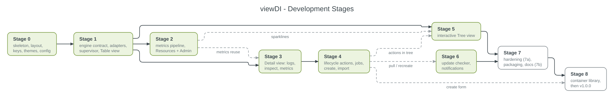
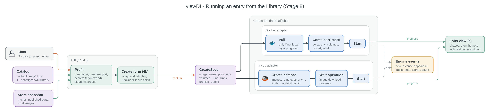

# viewDI — Phase 2: Development Plan

Status: **Validated (Phase 2)** · Date: 2026-10-28

Companion document: `05-quality-plan.md` (testing, resilience, rendering performance).

## 1. Roadmap

Solid arrows are hard dependencies; dashed arrows mean "reuses components from".
After Stage 1, Stages 2, 3 and 5 can start in parallel, with two exceptions inside
Stage 5: task 5 (live sparklines in the inspector) needs the Stage 2 metrics pipeline and
sparkline component, and task 7 (lifecycle actions in the tree) needs Stage 4. Stage 5 can
build everything else first and is only *done* once Stages 2 and 4 are merged. The order
below is the recommended serial order for a single developer, which satisfies both.

| Stage | Theme | Relative size | Release tag |
|---|---|---|---|
| 0 | Skeleton, layout, keyboard navigation, theme engine, config | M | `v0.1.0` |
| 1 | Engine contract, Docker + Incus adapters, supervisor, Table view | L | `v0.2.0` |
| 2 | Metrics pipeline, Resources dashboard, Admin dashboard, alerts | L | `v0.3.0` |
| 3 | Detail view: Overview, Logs, Inspect, Network, Volumes, Resources | L | `v0.4.0` |
| 4 | Lifecycle actions, job runner, create forms, import | L | `v0.5.0` |
| 5 | Interactive Tree view (5a), labs and animated links (5b) | M | `v0.6.0`, `v0.6.1` |
| 6 | Update checker (6a), acting on updates and desktop notifications (6b) | M | `v0.7.0`, `v0.8.0` |
| 7 | Hardening (7a), packaging and docs (7b) | M | `v0.9.0`, `v1.0.0` |
| 8 | Container library: run well-known Docker and Incus images from a catalog | M | `v1.2.0` |
| 9 | Simpler navigation: Home with one card per app, Machines, Activity (9a); `ctrl+k` palette, action menu, shell, raise a limit (9b) | L | `v1.3.0` |

Sizes: S ≈ a few sessions, M ≈ one to two weeks part-time, L ≈ two to three weeks part-time.

## 2. Working Agreement (applies to every stage)

1. **Validation gate:** before coding a stage, its task list below is reviewed and
   confirmed (or adjusted) by the user.
2. **Branch per stage:** `stage/N-short-name`, Conventional Commits, merged to `master`
   when the Definition of Done is met; tag the release.
3. **Mock-first:** every UI feature is demoable with `viewdi --mock` before it's wired
   to a real daemon. The fake engine grows with each stage.
4. **Definition of Done (global):**
   - `make lint test` green with `-race`; `goleak` clean.
   - New UI states covered by golden tests (80×24 and 120×40, at least two themes).
   - Every new failure path has a chaos scenario (see quality plan §3).
   - Performance budgets still met (`make bench`).
   - Diagrams regenerated if architecture changed; `CLAUDE.md` and docs updated.
   - A short `vhs` tape recorded for the stage demo (`docs/demos/stage-N.tape`).

---

## Stage 0 — Skeleton, Layout, Keyboard Navigation, Theme Engine

**Goal:** a polished, empty shell. Every later stage only adds content to it.

Tasks:
1. Repository bootstrap (git repo already initialised on `master`): `go.mod` (pin Bubble Tea/Bubbles/Lip Gloss v2),
   `Makefile`, `.golangci.yml`, `.editorconfig`, CI workflow (lint, test, golden).
2. `cmd/viewdi`: flag parsing (`--mock[=<scenario>]`, `--read-only`, `--debug`,
   `--trace[=<file>]`, `--pprof=<addr>`, `--theme`, `--refresh`; `--docker-host` and
   `--incus-socket` are parsed here and consumed in Stage 1), signal handling (SIGTERM/SIGINT clean exit, SIGTSTP/SIGCONT).
3. `internal/config`: XDG paths, `config.toml` load + validation + defaults, `state.json`
   atomic read/write, warnings surfaced as messages instead of startup failures.
4. `internal/ui/theme`: semantic token schema, TOML loader, embedded built-ins
   (Everforest dark/light, Dracula, Catppuccin Mocha/Latte, Monokai, Gruvbox, Nord,
   Tokyo Night), style cache, color profile degradation, user themes override built-ins.
5. `internal/ui/keys`: layered key map (modal → component → view → global) with help
   text, `keys.toml` overrides, conflict detection enforcing the reserved global and
   instance-action keys (`03-mockups.md`, Key map).
6. `internal/app`: root model, router for views `1`–`6` (placeholders), focus manager,
   modal stack, toast queue, banner slot.
7. Components: header (engine status placeholders + badge slot), tab bar, status/key-hint
   bar, help overlay (`?`), theme picker with live preview (`T`), confirm modal, toast.
8. Layout engine: responsive breakpoints (≥120 cols two-column layouts, 80–119 stacked,
   <80×24 "terminal too small" screen), resize handling.
9. Debug overlay (`ctrl+d`, only with `--debug`): FPS, frame time, message rate, goroutines.

Acceptance criteria:
- `viewdi --mock` starts in < 150 ms, navigates all six placeholder views with keys only.
- Theme switch is instant and persists in `state.json`; invalid theme file shows a
  warning toast and falls back to the default.
- Resizing never garbles the screen; tiny terminal shows the "too small" screen.

Risks: Bubble Tea v2 API churn → pin versions; ntcharts v2 compatibility → decide here
(adopt or write in-house sparkline in Stage 2). **Decided:** in-house sparkline/gauge, see
`01-research.md` §1.2.

Delivered notes (2026-10-28): demo recorded with `vhs` (`docs/demos/stage-0.tape` →
`docs/demos/stage-0.gif`); the CI `diagrams` job checks that `generate.py` runs instead of byte-comparing
PNGs (see `05-quality-plan.md` §1.4).

---

## Stage 1 — Engine Contract, Adapters, Supervisor, Table View

**Goal:** real data from both daemons in a fast, filterable table, with graceful
degradation when either daemon is missing.

Validated by the user on 2026-10-29 (task list unchanged).

Tasks:
1. `internal/engine`: domain types (`Instance`, `Network`, `Volume`, `Event`, `EngineInfo`,
   `Capabilities`, `Extra` per engine) and the `Engine` interface (read-only subset now:
   `Ping`, `Info`, `ListInstances`, `Inspect`, `Events`, `Networks`, `Volumes`).
2. **Engine contract test suite** (`internal/engine/enginetest`): one shared suite that
   any adapter must pass.
3. `provider/fake`: in-memory engine with a scenario DSL (add/remove/state-change,
   latency, hang, disconnect, permission error) — passes the contract suite.
4. `provider/docker`: socket discovery (flag → `DOCKER_HOST` → config → rootless →
   rootful), API version negotiation, list/inspect/networks/volumes, events stream,
   mapping to domain types.
5. `provider/incus`: socket discovery (flag → `INCUS_SOCKET` → config → `unix.socket` →
   `unix.socket.user`), projects, `GetInstancesFull`, networks/storage/profiles, events
   WebSocket, capability detection for restricted sockets.
6. Fixture recorder dev tool (`scripts/` or `cmd/fixturerec`, build-tagged) that captures
   real API responses into `testdata/` with sanitisation of hostnames/IPs/secrets.
7. `internal/supervisor`: state machine (Connecting/Connected/Degraded/Unavailable),
   exponential backoff with jitter, ping watchdog, periodic full resync (30 s),
   permission hint generation.
8. `internal/store`: instance index keyed by stable IDs, event application, snapshots.
9. Message pump: re-arming `tea.Cmd`, coalescing of bursty event streams.
10. Table view: columns (engine, name, kind, state, image, uptime; CPU/MEM placeholders),
    sort by any column (`o` cycle column, `O` reverse), `/` fuzzy filter, `e` engine filter, `P` Incus project selector,
    virtualised rendering, selection preserved across refreshes.
11. Header shows real engine status; reconnect banner; red "Unavailable" card with hint.

Acceptance criteria:
- With both daemons: list matches `docker ps -a` + `incus list` (all projects selectable).
- Stopping `incusd` while running: banner within ≤ 5 s, Docker data unaffected, automatic
  recovery after restart without user action.
- User not in `incus-admin`/`docker` group: app starts, shows actionable hint.
- 500 fake instances: table scroll stays within the frame-time budget.

Delivered notes (2026-10-29):
- The upstream Incus client stores the request context in the shared client value
  (`WithContext` mutates it) and dispatches each event on its own goroutine. The adapter
  therefore derives a fresh client per call (`UseProject` + `WithContext`) and reads the
  events websocket itself, which keeps events in order.
- The Docker list endpoint has no start time: uptimes come from bounded (8 concurrent),
  cached inspect calls, invalidated by events and after 5 minutes.
- Fixture sets for Docker API v1.52 and Incus 6.0.5 are **hand-written** from the API
  references (`"recorded": false` in their `index.json`) because no daemon was available;
  `make fixtures ENGINE=docker|incus` (`cmd/fixturerec`, build tag `fixturerec`) records
  sanitised replacements through a recording proxy. The acceptance checks against real
  daemons (`docker ps -a` + `incus list`, stopping `incusd`, group membership) remain to
  be run manually; the same behaviour is covered with the fake engine (supervisor tests
  and `internal/app/chaos_test.go`).
- The scenario DSL is the Go builder only (the optional YAML form is not implemented);
  `logflood` and `offline` reuse the homelab world until Stages 3 and 6.
- Measured: one key press plus a full frame with 500 instances ≈ 2 ms at 120×40.
- `internal/clock` (injectable clock with a fake) and `internal/fixtures` (fixture
  server, recorder, sanitiser) were added to the package layout.
- Demo recorded with `vhs` (`docs/demos/stage-1.tape` → `docs/demos/stage-1.gif`); merged
  in blokxz/viewDI#1 and tagged `v0.2.0`. Still open, needing a host with real daemons:
  recorded fixtures (`make fixtures`) and the three real-daemon acceptance checks.

---

## Stage 2 — Metrics Pipeline, Resources Dashboard, Admin Dashboard

**Goal:** accurate global and per-engine real-time consumption at a low host cost.

Validated by the user on 2026-10-29, with two adjustments: (a) the engine contract gains a
`Stats` capability (cumulative per-instance counters) implemented by both adapters and the
fake, whose scenario DSL gains synthetic metric profiles; (b) the ±5 % accuracy and < 2 %
CPU criteria are verified on a real host — in CI they are covered with the fake engine,
cgroup fixtures and benchmarks.

Tasks:
1. `internal/metrics/cgroup`: cgroup v2 reader (`cpu.stat`, `memory.current`,
   `memory.stat`, `io.stat`), path resolution via `/proc/<init-pid>/cgroup` with layout
   fallbacks: Docker systemd/cgroupfs drivers, rootless Docker under
   `user@<uid>.service`, Incus `lxc.payload.<name>` (default project) and
   `lxc.payload.<project>_<name>` (other projects) — see `01-research.md` §3.2.
   Incus VMs are excluded (API-only metrics; guest figures require `incus-agent`).
2. Network counters: Incus instance state / `/1.0/metrics`; Docker via one-shot stats
   (low rate) or `/proc/<pid>/net/dev` of the container's init PID when readable.
3. OpenMetrics parser for Incus `/1.0/metrics` (fuzzed).
4. Rate computation (counters → per-second rates, counter reset/wrap handling), per-
   instance ring buffers (default 5 min at 1 s), per-engine aggregation.
5. Sampling scheduler: adaptive rate (visible/foreground vs hidden/unfocused), fallback
   chain (cgroup → engine API) per instance, sampling health indicator.
6. Components: sparkline (in-house, see `01-research.md` §1.2), gauge bar, mini-table "Top consumers".
7. Resources dashboard (`2`): per-engine panels (CPU, RAM, NET, DISK), top consumers
   (sortable with `o`/`O`),
   refresh-rate control (`+`/`-`), stale marking for degraded engines.
8. Alert engine: rules (unhealthy healthcheck, restart loop, memory > threshold, CPU
   sustained > threshold, engine degraded/unavailable), dedup + auto-resolve,
   thresholds in `config.toml`.
9. Admin dashboard (`1`): daemon cards (version, counts, storage driver, cgroup version,
   socket type), alerts panel, recent events feed, shortcuts panel.
10. Table view gains live CPU% / MEM columns.

Acceptance criteria:
- Dashboard totals within ±5 % of `docker stats` / `incus info` on a reference host.
- With 50 running containers at 1 Hz: viewDI CPU < 2 % of one core (see budgets).
- Alerts appear and resolve automatically; no duplicate alerts on reconnect.

Delivered notes (2026-10-29):
- `engine.Stats` reads cumulative counters for many instances in one call: Docker one-shot
  stats (memory without the inactive page cache, like `docker stats`), Incus one
  `/1.0/metrics` request (fuzzed OpenMetrics parser) with an instance-state fallback for
  restricted sockets, synthetic profiles (flat / sine / spike) in the fake.
- Sampler: one pass per interval over every running instance of every connected engine;
  cgroup v2 first (path from `/proc/<pid>/cgroup`, then the known layouts; a failing
  cgroup moves the instance to the API path for 60 s), one `Stats` batch per engine for
  the rest. Interval: the refresh rate while Admin, Resources or Table is visible and the
  terminal focused, 5 s otherwise; `+`/`-` step 250 ms–2 s. Measured: a 50-container
  cgroup pass ≈ 2.5 ms.
- History: 300 points per instance and per engine (5 min at 1 s); passes are lossy.
- Alerts (`internal/alerts`) are evaluated in the UI goroutine on every change and on
  the render clock; alerts of a disconnected engine are frozen until it reconnects.
- The ±5 % accuracy and < 2 % CPU criteria still need a real host; CI covers them with
  the fake engine, cgroup fixtures and benchmarks.
- Demo: `docs/demos/stage-2.tape` → `docs/demos/stage-2.gif`.

---

## Stage 3 — Detail View

**Goal:** everything about one instance, with live logs and metrics.

Validated by the user on 2026-10-29, with two adjustments: (a) log streaming and the
per-instance stats stream join the engine contract (`Logs`, `WatchStats`, plus
`InspectRaw` for the Inspect tab), implemented together by both adapters and the fake,
whose log generator brings the `logflood` scenario to life; (b) logs from real daemons
are checked on a real host — CI covers them with fixtures and the fake engine.

Tasks:
1. Detail view container with tab bar (Overview, Logs, Inspect, Network, Volumes,
   Resources), breadcrumb, persistent last-used tab per engine.
2. Registry `Subscribe`/`Unsubscribe` with cancellable contexts; goroutine leak tests.
3. Overview tab: description (OCI labels `org.opencontainers.image.*`, Incus
   `image.description`/`user.*`), image, command, restart policy, health, compose/project,
   labels, env with secret masking (`v` to reveal one value).
4. Logs tab: Docker follow + `stdcopy` demux; Incus console log polling / attach and log
   files; ring buffer (10 k lines, configurable); pause with "+N new" counter; regex
   filter with match highlighting (`ctrl+n`/`ctrl+p` next/prev match); stdout/stderr stream
   cycle (`S`); wrap; timestamps; jump
   top/bottom; **terminal-escape sanitisation**; per-line length cap.
5. Inspect tab: collapsible structured view of the raw inspect document (JSON → tree),
   search inside, copy path (OSC 52 clipboard).
6. Network tab: interfaces, IPs, MAC, ports, attached networks, per-NIC rates (Incus).
7. Volumes tab: mounts/devices, type (bind/volume/tmpfs/disk device), RO/RW, usage when
   available.
8. Resources tab: per-instance stream (Docker `stats?stream=1`, Incus state 1 s), larger
   charts, limits overlay (CPU quota, memory limit), PIDs, time-window control.
9. Instance removed while open → tab shows "instance removed" state instead of erroring.

Acceptance criteria:
- 1 000 log lines/s for 60 s: UI stays responsive, memory bounded, no dropped-UI frames
  beyond budget, drop counter visible when filtering can't keep up.
- Opening/closing detail 100 times leaves zero extra goroutines.

Delivered notes (2026-10-29):
- Engine contract: `InspectRaw`, `Logs(opts)` (tail, since, follow; lines capped at 8 KiB)
  and `WatchStats(interval)` (samples with per-interface counters and, on Incus, per-disk
  usage); the contract suite checks all three on every backend. `engine.Stream[T]`
  generalises the event feed.
- Docker: one inspect (TTY or not), then `logs?follow&timestamps` demultiplexed in-house
  (frames need not be line-aligned; daemon error frames end the stream);
  `stats?stream=true` throttled to the interval. Incus: the console ring buffer (stdout)
  and `lxc.log`/`qemu.log` (system) are polled every second and diffed (the console has
  no follow endpoint); instance state is polled for stats. Fixture sets and the recorder
  gained these endpoints (multiplexed frames are sanitised frame by frame).
- `internal/streams`: one subscription per open detail; logs, stats and inspect each run
  in their own goroutine with backoff (1 s → 30 s), resume after a failure from the last
  timestamp without duplicates, stop on not-found/permission, and wait for `Refresh`
  (sent by the app when the instance or its engine changes) after a clean end. Lines are
  sanitised there (`internal/textsafe`, fuzzed), at most 5 000 lines wait for the UI
  (oldest dropped and counted), and batches are at most 10 per second.
- UI: `logview` (bounded ring, default 10 000 lines, `[logs] buffer_lines`), `jsontree`
  (ordered, collapsible, search, jq-style path copied with OSC 52, 50 000-node cap,
  fuzzed), `secret` (masking for env values and secret-looking keys, also inside the
  Inspect tree), multi-row charts. The last tab is remembered per engine in state.json.
- Measured (`TestLogFloodStaysResponsive`, `VIEWDI_LONG=1` for 60 s at 1 000 lines/s):
  worst key latency 40 ms, buffer at its cap, heap 3.6 MB; 100 open/close cycles leave
  no subscription or goroutine (`TestDetailOpenClose100`, goleak).
- Still to check on a real host: Docker TTY containers, Incus VM console logs, and
  per-NIC rates against `incus info`.
- Demo: `docs/demos/stage-3.tape` → `docs/demos/stage-3.gif`.

---

## Stage 4 — Lifecycle Actions

**Goal:** safe, observable management operations.

Validated by the user on 2026-10-29, with three adjustments: (a) delivered in two PRs —
**4a** (tasks 1–4, 7, 8: actions, jobs, delete, read-only, optimistic UI; `v0.5.0`) and
**4b** (tasks 5–6: create forms and import; `v0.5.1`); (b) destructive operations are
covered in CI by the fake engine and hand-written fixtures, and checked against real
daemons on a real host; (c) safer defaults: stop waits 10 s before killing
(configurable), delete never removes named volumes, Incus stop-then-delete is off unless
ticked in the dialog.

Tasks:
1. Extend `Engine` with mutating capabilities; contract tests for each (fake + fixtures).
2. `internal/jobs`: job registry, progress reporting (Incus operations, Docker pull/load
   progress JSON), cancellation, Jobs view (`5`) with history.
3. Start (`s`) / stop with timeout (`x`) / restart (`R`) / pause-freeze ↔ unpause toggle
   (`F`); multi-select in Table
   (`space` to mark, action applies to all marked).
4. Delete with confirm modal (type-the-name for running or with volumes); options:
   force, remove anonymous volumes (Docker), stop-then-delete (Incus).
5. Create forms (form component with validation):
   - Docker: image (with local image autocomplete), name, ports, env, volumes, network,
     restart policy, labels; optional pull.
   - Incus: image source (local alias, remote `images:` with search), name, type
     container/VM, profiles, CPU/memory limits, network, storage pool.
6. Import: file picker component; Docker image tarball (`load`), rootfs tarball
   (`import`), Incus instance backup, Incus image; progress + resulting instance/image.
7. `--read-only` and restricted-capability enforcement: actions hidden/disabled with a
   reason in the help bar.
8. Optimistic UI: action marks the row "pending"; the authoritative state comes from the
   event stream; timeout → error toast and resync.

Acceptance criteria:
- Every action is reversible or confirmed; no destructive action without a modal.
- Daemon dies mid-operation → job marked failed with a clear message, UI unaffected.

Delivered notes, Stage 4a (2026-10-29):
- Engine contract: `Act(start/stop/restart/pause/unpause)` and `Delete(force, anonymous
  volumes, stop first)`, plus the `conflict` error class. Actions already in effect
  succeed (Incus is checked first since it rejects them); the contract suite covers
  actions, idempotence, conflicts and not-found on every backend and the resulting states
  on stateful ones. Fixtures for the action endpoints are hand-written; checking them
  against real daemons stays on a real host.
- `internal/jobs`: one job per target with its own context and timeout, four at once,
  cancel, panics → failed jobs; the Jobs view (`5`) shows them (`c` cancels).
- Store: pending marks per instance, confirmed by the engine's events, or expired after
  10 s with a warning and a resync.
- UI: action keys on marked rows or the selection, bulk confirmation, the delete dialog
  (Cancel focused, options unticked, name or count typed when running or volume-backed),
  a status-bar reason for `--read-only` and restricted engines, `[actions] stop_timeout`.
- Tests: `TestDaemonDiesMidAction` (the real program; the job fails with the daemon's
  reason, the row leaves its pending state) and `TestStopThroughTheProgram`, stub-runner
  flows, dialog unit tests, golden frames.
- Demo: `docs/demos/stage-4a.tape` → `docs/demos/stage-4a.gif`.

Delivered notes, Stage 4b (2026-10-29):
- Engine contract: `Images`, `SearchImages`, `Create(spec, progress)` and
  `Import(spec, progress)`, with spec parsers and validators in `internal/engine`
  (ports, env, volumes, labels, names, image references, memory sizes; fuzzed). Docker:
  optional pull with summed layer progress, `ContainerCreate`, start; `docker load` and
  `docker import` with upload progress. Incus: create from a local alias or
  `images:<alias>` (download progress from the operation), search through the remote's
  simplestreams index (fetched on demand, capped at 64 MiB, cached 1 h, filtered to the
  host architecture); backup and image import with upload and operation progress. The
  contract suite covers images, search, create (duplicate name → conflict, missing image
  → not found) and every import kind on every backend; adapter unit tests cover request
  mapping, pull progress, load results and simplestreams parsing.
- Jobs: creates and imports run as jobs (30-minute bound, no pending mark) whose
  progress is throttled to 100 ms; the Jobs view shows a bar or the result, and a toast
  names what was made.
- UI: a reusable form modal (validation on leave and submit, substring suggestions,
  remote search, secrets masked when unfocused, scrolling on small screens) and a file
  picker modal (listings in commands, extension filter, hidden files, names sanitised).
  `n` → engine choice → create form; `i` → import kind → file → remaining fields.
  `--read-only`, restricted connections and disconnected engines are explained in a
  toast instead.
- Tests: driver flows for both forms and an import, golden frames (forms, file picker,
  Jobs progress), `TestCreateThroughTheProgram` and `TestDaemonDiesMidCreate` (the job
  fails, nothing half-made remains, the UI keeps working).
- Still to check on a real host: pulls from private registries, VM creation, imports of
  large backups (the upload is streamed, never buffered).
- Demo: `docs/demos/stage-4b.tape` → `docs/demos/stage-4b.gif`.

---

## Stage 5 — Interactive Tree View

**Goal:** the navigable tree from `03-mockups.md` M4 and `02-architecture.md` §5, plus labs:
blocks of machines the user groups and links by hand.

Validated by the user on 2026-11-01, after an animated mock-up of the result, with these
adjustments: (a) delivered in two PRs — **5a** (tasks 1–8, the tree; `v0.6.0`) and **5b**
(tasks 9–11, labs and animated links; `v0.6.1`); (b) the Profile grouping and leaves for
other Incus devices (GPU, USB…) are postponed, since they need a contract change; (c) the
`⬆` update marker arrives with Stage 6; (d) the animation's frame interval is a setting.

Tasks (5a):
1. Generic `tree` component (`internal/ui/components/tree`): nodes with stable IDs, a
   flattened visible-node list rebuilt only when data or expansion change, virtualised
   rendering, guides (`├── └── │`, `tree_guide` token), full-width cursor row, collapsed
   nodes with `▸ n`. A node that disappears moves the cursor to its nearest sibling, else
   its parent.
2. Navigation keys (`↑↓`/`jk`, `←→`/`hl`, `[` `]`, `space`, `*`, `-`, Home/End,
   PgUp/PgDn); `enter` opens the Detail view on an instance or one of its leaves.
3. Groupings, cycled with `g` (network → project → compose → engine only); the cursor stays
   on the same machine:
   - network: each engine's networks with their members (empty networks are hidden;
     machines without a network go under "(no network)");
   - project: Incus projects; Docker stays flat under its engine;
   - compose: Docker Compose projects plus "(standalone)"; Incus stays flat;
   - leaves: ports, mounts and "also on: …" for extra networks.
4. Multi-network machines: the primary occurrence is the alphabetically first network,
   the others are marked `⇄`; `J` jumps to the next occurrence and opens its ancestors. A
   breadcrumb (`Docker › web_default › web-api`) titles the tree.
5. Inspector with a renderer per node type (root, engine, network/group, instance, leaf):
   store snapshots only, never daemon I/O, debounced (≈80 ms); instances show CPU, memory
   and network sparklines from the Stage 2 sampler. Beside the tree from 100 columns
   (55/45), below it (6 lines) on narrower screens.
6. Filter `/`: name, image, network and IP; matches stay visible with their ancestors;
   match count; `ctrl+n`/`ctrl+p` next/previous match; `esc` clears it and the previous
   expansion returns.
7. Lifecycle actions `s x R F d` on the focused machine (or the one owning the focused
   leaf), reusing Stage 4 (confirm, delete dialog, pending marks, read-only/restricted).
   No multi-select: `space` folds.
8. `state.json` `tree`: the grouping and, per grouping, the nodes the user opened or
   closed against the default (engines and groups open, machines closed), capped at
   2 000. ASCII icons (`[D] [I] * #`) with `[ui] ascii_icons = true`, or automatically on
   `TERM=linux` or a non-UTF-8 locale.

Tasks (5b):
9. Labs: user-defined blocks of machines from both engines, stored in
   `~/.local/share/viewDI/labs.json` (atomic writes, versioned); machines identified by
   engine + project + name so recreated containers stay in their lab; a deleted machine
   stays as "missing" with its links; a machine can be in several labs; `--read-only`
   does not block labs (nothing is written to the daemons).
10. A `lab` grouping (after "engine only"): each declared link A ↔ B is a lane drawn to the
    right of the members (rounded corners, crossings), greedy lane columns; the inspector
    lists a machine's links and a lab's members. `L` opens the lab menu: new lab, add to
    lab, link with… (picker of both engines' machines), remove link, remove from lab,
    rename, delete lab (confirm modal).
11. Animated links: a dot runs along a lane while both ends are running, faster with more
    traffic (three speeds from the sampler's network rates); a lane with a stopped end is
    grey and still. The tick runs only while the Tree view shows an active lane.
    `[tree] animation = true` and `[tree] animation_ms = 125` (frame interval, 40–1000 ms)
    in `config.toml`; off with `NO_COLOR`; `o` instead of `●` with ASCII icons. Tests
    drive frames with fixed times.

Acceptance criteria:
- Holding `↓` over 1 000 nodes scrolls smoothly within the frame budget.
- Cursor and expansion survive live state changes and reconnects.
- 5b: lanes never overlap; the animation costs no CPU when no lane is active.

Delivered notes, Stage 5a (2026-11-01):
- `internal/ui/components/tree`: nodes with stable IDs and a default expansion; the
  model keeps only the nodes the user toggled against their default (what `state.json`
  stores), flattens the visible rows on data, expansion or filter changes (≈0.3 ms for
  1 000 nodes), keeps the cursor on its node ID (else the sibling at its place, else the
  nearest ancestor), filters with ancestors kept, and draws only the rows on screen with
  Unicode or ASCII guides and a full-width cursor row.
- `internal/ui/views/tree`: builders for the four groupings (empty networks hidden,
  "(no network)" and "(standalone)" catch-alls, leaves for ports, mounts and other
  networks, `⇄` on secondary occurrences), one tree per grouping so each keeps its own
  cursor and folds; inspector renderers for the root, engines, networks, projects and
  Compose groups, machines (state, image, IPs, ports, mounts, health, CPU/MEM/NET
  sparklines) and leaves; breadcrumb as the panel title; the grouping in the tab bar.
  The inspector is debounced 80 ms in the app (`InspectDelay`), immediate in tests.
- App: Tree view wired as view 4, in the fast metrics interval, lifecycle keys and
  `enter` on the focused machine or the machine owning the focused leaf;
  `[ui] ascii_icons`, also turned on by `TERM=linux` and non-UTF-8 locales.
- Tests: component unit tests (navigation, persistence, cursor recovery, filter,
  rendering), view tests (groupings, leaves, `J`, `g`, filter, debounce, layouts, ASCII,
  unique IDs), app flows (actions and delete from the tree, detail, persisted state, the
  cursor through a state change, an outage and a reconnect), golden frames,
  `TestTreeScroll1000FrameBudget` (≈1.8 ms per key and frame with 1 000 instances).
- Demo: `docs/demos/stage-5a.tape` → `docs/demos/stage-5a.gif`.

Delivered notes, Stage 5b (2026-11-01):
- `internal/config`: `labs.json` in the data directory (`LoadLabs`/`SaveLabs`, version 1,
  0600, atomic). Limits: 64 labs, 256 members and 512 links per lab, names up to 40
  characters. Lab IDs are never reused. A corrupt file is moved to `labs.json.bak`; a
  repairable one (bad or duplicate IDs, bad names, duplicate members, self links, links
  to non-members, over the limits) is normalised, with a warning for each rename or cut. `[tree] animation` and `animation_ms` (40–1000, default 125).
- Tree view: the `lab` grouping (each lab, its members sorted by name, missing members,
  then "(not in a lab)" closed by default); lanes in a column area right of the tree,
  greedy columns per lab, box-drawing joins and crossings, idle (grey), active, and
  highlighted when an end is under the cursor; a one-cell gap keeps right-aligned
  details off the stubs. Lab rows show links and active links; the inspector shows a
  machine's labs and links, a lab's members and links, a missing member's engine.
- `L` menu entries depend on the node: on a machine, new lab with it, add to a lab, link
  with… (every machine of both engines plus the lab's missing members, "· linked" on
  existing ones), remove a link, remove from the lab; on a lab, rename and delete
  (confirm). The `L` hint shows in the footer only in the lab grouping (it is always in
  help), so the other groupings keep room for the actions.
- Animation: three speeds (below 16 KiB/s, below 1 MiB/s, above; the two ends' summed
  rates), one Render per run of same-style cells. While a chain runs, the per-message
  visibility check costs a comparison; the chain re-checks on each frame.
- App: lab modal results go to the Tree view before the read-only check; failed saves
  show an error toast; `--mock` uses an in-memory demo lab (`web-stack`, both engines);
  `NO_COLOR` or `animation = false` turn the dots off.
- Tests: labs store (editing, round trip, corrupt and repaired files), lab grouping and
  missing members, `TestLanesNeverOverlap`, lane states and rendering, tier speeds,
  animation only while an active lane is on screen, menu flows, inspector; app flows
  (labs under `--read-only` through the confirm modal, save failure, the tick only while
  visible); golden frames for the lab grouping and its menu; `TestTreeLabs1000FrameBudget`
  (1 000 machines in 20 labs with the animation on, p99 under 8 ms).
- Demo: `docs/demos/stage-5b.tape` → `docs/demos/stage-5b.gif`.

## Stage 6 — Update Checker and Notifications

**Goal:** `01-research.md` §3.4 implemented end to end: viewDI finds engine and image
updates, tells the user once, and offers the actions; it never installs anything.

Validated by the user on 2026-11-01, with adjustments (a)–(c) below. Delivered in two PRs, like Stage 5:
**6a** (tasks 1–7: finding and showing updates; `v0.7.0`) and **6b** (tasks 8–11: acting on
them and desktop notifications; `v0.8.0`). Adjustments to §3.4: (a) `incus rebuild`
is not offered as an action, only shown as a hint with its warning (it wipes the root
filesystem); (b) the security flag comes only from the package changelog or the release
title/body naming a CVE, never guessed from the version number; (c) `--mock` gets fake
update sources so the whole stage can be demonstrated and tested without network.

Tasks (6a):
1. Engine contract: `ImageUpdateStatus(ctx, ref)` in `engine.Engine`, both adapters and the
   fake, covered by `enginetest` and recorded fixtures.
   - Docker: `DistributionInspect` manifest digest vs the local image's `RepoDigests`; the
     daemon does the registry auth, so private registries work with `docker login`.
     Images without a registry reference (built or imported locally) report "local".
   - Incus: the instance's `volatile.base_image` vs the current fingerprint of its source
     alias on the simplestreams remote (`images:debian/12`).
   - Results: `up-to-date`, `available` (local and remote digests), `local`, `unknown`
     (with a classified error). `Capabilities.ImageChecks` is false when the socket or
     project cannot do it.
2. `internal/updates` core: domain types (`Update{Subject engine|image, Engine, Ref,
   Instances, Current, Available, Level patch|minor|major|security, Source, NotesURL,
   Hint}`), level from `golang.org/x/mod/semver`, scheduler (first run 30 s after startup,
   `engine_interval`, `image_interval`, manual trigger `U`, one run at a time, injected
   `Clock`), diff vs the last seen set, `ignore_images` globs.
   - Cache `~/.cache/viewDI/updates.json`: versioned, atomic writes, ETags, last results
     and "last seen"; a corrupt cache is dropped with a debug-log line (it is a cache).
   - Snooze (7 days) and "ignore this version" live in `state.json`, keyed by subject and
     version, so a newer version shows again.
   - Every source sits behind an interface (`Runner` for subprocesses, `http.Client` for
     HTTP); with `enabled = false` no source is even built.
3. Engine sources:
   - Package managers: apt (`apt-cache policy`), dnf (`dnf check-update`), pacman
     (`pacman -Qu`, plus `pacman -Q` for the installed version; it is only as fresh as the
     last database sync, which viewDI never runs), zypper
     (`zypper --xmlout list-updates`). Detected by binary on `PATH`, run read-only with
     `LC_ALL=C` and a 20 s timeout, output capped at 1 MiB and sanitised; each parser fuzzed.
     The upgrade hint is the exact command for that manager.
   - Upstream: GitHub releases of `moby/moby` (`docker-v*`) and `lxc/incus` with
     `If-None-Match`; `GITHUB_TOKEN` honoured from the environment, never stored; a 403/429
     rate-limit backs off until the reset time.
   - `engine_source = auto` prefers the package manager and falls back to upstream when the
     package is not managed. Incus channel: LTS when the installed version is `6.0.x`,
     otherwise feature releases; `incus_channel` overrides it.
4. Image checks: one query per image reference (not per container), at most 4 at a time,
   results cached per reference until the next `image_interval`; each instance links to
   its reference so the markers follow it.
5. In-app notifications (store + UI, from the diff only):
   - header badge `⬆ N` next to the engine status;
   - admin alerts through `internal/alerts`: one per engine update, one aggregated for
     images ("5 images have updates"), auto-resolved when the update disappears;
   - `⬆` marker in the Table (name column) and the Tree (machine rows; the inspector shows
     current → available);
   - toast (M6) only for newly found updates, never repeated;
   - a failed check shows "last check failed: …" once in the Updates view header and a
     debug-log line; it never stalls the UI or repeats a toast.
6. Updates view `6` (M6): engines table and images table, sortable (`o`/`O`), with
   last check time and source. Keys in 6a: `enter` opens the release notes with
   `xdg-open` (a tea.Cmd; a toast with the URL when it is missing), `z` snooze, `I`
   ignore version (both reversible from the view: `I` again on an ignored row), `U` check
   now. The placeholder for view 6 is removed.
7. `--mock`: fake sources (no subprocess, no network) driven by the scenario: `homelab`
   finds an Incus LTS security fix, a Docker minor release and three outdated images;
   `offline` fails every check; `chaos` hangs the image source. Import rules: `internal/ui`
   may import `updates` domain types only (like `alerts`), never its sources.

Tasks (6b):
8. Pull: `p` on an image row starts a pull job (Stage 4 jobs, progress in Jobs view) and
   re-checks that reference when it ends. Docker pulls the reference; for Incus, `f`
   refreshes the cached image (new contract method `RefreshImage`, a no-op error on
   Docker). Both respect `--read-only` and
   restricted projects.
9. Recreate for standalone Docker containers (`c`): a diff preview modal (image digest
   old → new; name, env, ports, mounts, networks, restart policy and labels kept), then the
   confirm modal; the job stops, renames the old container to `<name>-old`, creates and
   starts the new one, and removes the old one only after the new one is running
   (rolls back otherwise). Compose-managed containers show the
   `docker compose -p <project> up -d <service>` hint instead; Incus shows the
   `incus rebuild` hint with its warning.
10. Desktop notifications (opt-in, `notify_desktop = true`): D-Bus
    `org.freedesktop.Notifications.Notify` via `godbus/dbus/v5` on the session bus,
    `notify-send` fallback, nothing when neither exists (one debug-log line). Only for the
    diff and at or above `notify_min_level`; never in `--mock` unless asked with a flag.
11. Tests, docs, demo: golden frames for view 6 (engines, images, failed check), the badge
    and the markers; flow tests for snooze/ignore, pull, recreate (success and rollback),
    read-only; chaos scenario "image source hangs"; README, mockups, CLAUDE.md;
    `docs/demos/stage-6a.tape`/`stage-6b.tape`.

As built (6b):
- The contract gained three methods, not one: `PullImage` (Docker; Incus answers
  "unsupported"), `RefreshImage` (Incus; Docker answers "unsupported") and `Recreate`
  (standalone Docker containers). Unsupported calls are a conflict wrapping
  `engine.ErrUnsupported`, so the contract suite checks them on both engines.
- After a pull the image is "pulled but not recreated": the checker compares each
  container's image ID with the local image of its reference and keeps the row (status
  `pulled · recreate`) for the containers still on the old build, without a new toast.
  Every successful pull, refresh or recreate triggers an image-only re-check.
- Recreate keeps the container's own settings and drops what came from the old image
  (default env, cmd, entrypoint, labels, exposed ports, volumes, healthcheck), so the
  new build's defaults apply; anonymous volumes are carried over by name.
- Desktop notifications: one per report, critical urgency when it lists a security
  update, text sanitised and markup escaped; snoozed and ignored updates never notify.
  `--mock-notify` is the flag that allows them in `--mock`.

Acceptance criteria:
- With `updates.enabled = false` a test with a transport and a `Runner` that fail on any
  use proves zero outbound requests and zero subprocesses.
- Offline host: one "last check failed" message, no repeated toasts, no UI stalls; the
  next scheduled check still runs.
- The same update never toasts twice, across restarts too (last seen is cached).
- 6b: a failed recreate leaves the original container running under its own name.

---

## Stage 7 — Hardening, Packaging (`v0.9.0`, `v1.0.0`)

**Goal:** what `05-quality-plan.md` promises but the code does not do yet, then a release
anyone can install: packages, a man page, user docs.

Validated by the user on 2026-11-02, with adjustments: (a) delivered in two PRs, like
Stages 5 and 6: **7a** (tasks 1–8: hardening; `v0.9.0`) and **7b** (tasks 9–12: packaging
and docs; `v1.0.0`); (b) the license is Apache-2.0; (c) the AUR package is in scope; (d)
the user runs the real-daemon chaos runbook on their own host, outside CI.

Gaps found on `master` before the stage (2026-11-02): no crash report for a UI panic (F13);
no `integration`-tagged test, so `make test-integration` runs nothing; no nightly job;
the benchstat gate is commented out in `ci.yml`; `NO_COLOR` turns off the animation and the
terminal colour query but every theme still relies on colour; no `LICENSE`, issue template,
`CHANGELOG.md`, man page or release tooling.

Status (2026-11-02): **7a is implemented** on `claude/optimistic-mayer-9c00fw` (tasks 1–8).
Not verifiable from the build sandbox, so they wait for the first CI and nightly runs: the
integration suite against real daemons (no sockets there), `govulncheck` (no access to the
vulnerability database) and the chaos runbook (run by the user).

Status of 7b (2026-11-02): tasks 9–12 are written. `goreleaser release --snapshot --clean`
builds every artifact here and the `.deb` installs; `release.yml` and the AUR upload run only
for a real release, and `makepkg` needs Arch (the `package()` step was checked by hand
against the snapshot tarball).

Tasks (7a):
1. **Crash report (F13):** recover a panic in the program, restore the terminal, write
   `~/.local/state/viewDI/crash-<ts>.log` (version, Go version, `$TERM`, stack, the last
   200 trace entries — the trace ring runs even without `--trace`), print its path on exit
   and exit non-zero. Regression test: a panic forced in `Update` leaves a readable log.
2. **Integration tests (`-tags=integration`):** the `enginetest` contract suite against the
   real Docker and Incus sockets; each engine is skipped when its socket is missing.
   Mutating tests use a throwaway prefix (`viewdi-it-*`) and clean up after themselves.
3. **Nightly workflow:** integration on a runner with Docker and Incus (Zabbly packages),
   each fuzz target for 5 minutes, `govulncheck`. A failing fuzz target uploads its corpus
   entry as an artifact.
4. **Real-daemon chaos runbook** `docs/06-chaos-runbook.md`: one procedure per F1–F19 row
   that can be provoked on a host (`systemctl stop`, `kill -STOP`, `chmod` on the socket,
   daemon restart mid-stream, full disk with a tmpfs `XDG_STATE_HOME`…), the expected
   behaviour and a results table. Run by the user; each bug found gets a fix and a fake
   scenario.
5. **Fuzzing campaign:** list every untrusted input (API payloads, log lines, package
   manager output, release feeds, registry responses, config, themes, keys, labs, cache,
   OpenMetrics, cgroup files) against the existing targets, add the missing ones, run a
   long campaign; every crash becomes a seed in `testdata/fuzz`.
6. **Performance pass:** measure every budget of `05-quality-plan.md` §4.1 (startup, idle
   CPU with 50 instances, frame p99 at 120×40 and 300×80, input latency under log flood,
   RSS) with benchmarks and `pprof`, record the numbers in the quality plan, fix what misses,
   and enable the benchstat gate (> 15 % regression fails `bench`).
   Added after review: a **soak test** (`scripts/soak.py`, nightly for 30 min on the chaos
   mock) that fails when heap or goroutines keep growing after the warm-up.
7. **Accessibility:** a built-in `monochrome` theme used when `NO_COLOR` is set or
   `[ui] monochrome = true`: bold, reverse, underline and glyphs instead of colour. Every
   state (running/stopped/paused, alert levels, selection, marks, update badge, banners,
   lanes) stays distinguishable; goldens in monochrome at 80×24 and 120×40.
8. **Security review** `docs/07-security-review.md`: socket handling (a `DOCKER_HOST` over
   TCP without TLS shows a warning), subprocesses (`xdg-open` only for `https` URLs, fixed
   argument lists, no shell, timeouts), file permissions of everything viewDI writes,
   pprof loopback check, untrusted text in notifications and toasts, `govulncheck` in CI.
   Findings are fixed or documented with a reason.

Tasks (7b):
9. **CLI:** `--help` with examples, the XDG paths and the environment variables; man page
   `viewdi(1)` generated from the flags (`go generate`, a test fails when it is stale);
   shell completions for bash, zsh and fish (`viewdi completion <shell>`).
10. **goreleaser:** static binaries (`CGO_ENABLED=0`) for amd64 and arm64, tarball, `.deb`
    and `.rpm` (nfpm) with the man page and completions, checksums. A `release.yml`
    workflow runs when a GitHub release is published and appends the assets to that
    release (tags are created with the release in the GitHub UI).
11. **AUR:** `packaging/aur/viewdi-bin/PKGBUILD` (+ `.SRCINFO`) built from the release
    tarball and its checksum; published by hand.
12. **User docs:** README for people who install it (packages, permissions: `docker` and
    `incus-admin`/`incus` groups, config, keys, demo GIFs); `CHANGELOG.md` built from the
    release notes `v0.1.0`…; `LICENSE` (Apache-2.0); a bug-report issue template (version,
    engines and versions, socket type, terminal, `$TERM`, scenario or trace file).

Acceptance criteria:
- 7a: a panic in the UI leaves a sane terminal and a readable `crash-*.log`.
- 7a: `make test-integration` passes against real Docker and Incus; the nightly job is green.
- 7a: every §4.1 budget is measured and met; a > 15 % benchmark regression fails CI.
- 7a: with `NO_COLOR` every state is distinguishable (goldens).
- 7a: `govulncheck` is clean; every security finding is fixed or documented.
- 7b: `goreleaser release --snapshot --clean` builds every artifact; the `.deb` and `.rpm`
  install the binary, the man page and the completions; `makepkg` builds the AUR package.
- The chaos runbook is complete for every F row that can be provoked on a host; the user's
  run is recorded in it (not a merge gate).

---

## Stage 8 — Container Library (`v1.2.0`)

**Goal:** browse a library of well-known Docker images (databases, web servers,
self-hosted apps) and Incus system images (Linux distributions, some with a cloud-init
preset), and run one in a few keys with sensible defaults already filled in.
Proposed by the user on 2026-11-02, planned for `v1.2.0`, Incus entries included at the
user's request; **task list validated 2026-11-02, delivered** (the delivered keys and the
differences from the sketches are in `03-mockups.md` M8). Screens: `docs/mockups/m8-library.svg`
(generated by `docs/mockups/src/m8-library.py`) and `03-mockups.md` M8.

How an entry becomes a container or VM: the view only reads the catalog and a store
snapshot, the prefill proposes a free name, free host ports and generated secrets, and
the user confirms the Stage 4b form. The form yields an ordinary `CreateSpec`, run by the
existing create job: Docker pulls (when the image is not local), creates and starts;
Incus creates the instance from the `images:` remote (downloading the image if needed,
with cloud-init in `Config`), waits for the operation and starts it. Progress goes to
Jobs; the new instance arrives through the engine events like any other.

Tasks:
1. **Catalog format and built-in library:** `library/*.toml` embedded with `go:embed` (like
   `themes/`). Every entry has an ID, name, category, description, engine, docs URL and a
   post-create note with placeholders (`{{name}}`, `{{port 5432}}`). Strict validation and
   a fuzzed parser.
   - Docker entries: image with a pinned tag (a major version, e.g. `postgres:17`), ports,
     environment (`required`, `generate = "password"` for secrets), named volumes and
     their container paths, restart policy. About 30 at first: databases (postgres, mysql,
     mariadb, redis, mongo), web and proxies (nginx, caddy, traefik, httpd), monitoring
     (prometheus, grafana, uptime-kuma), messaging (rabbitmq, mosquitto), self-hosted
     (nextcloud, gitea, vaultwarden, jellyfin, home-assistant, pihole, syncthing, minio,
     node-red), dev tools (adminer, code-server, registry), base images (alpine, debian,
     ubuntu, busybox). Only official or widely used publishers.
   - Incus entries ("Linux systems"): an alias on the `images:` remote, the kinds it
     supports (container, VM or both) and the default one, CPU and memory limits,
     profiles, and an optional cloud-init `user-data` preset (which needs a `/cloud`
     image). About 8 at first: Debian 12, Ubuntu 24.04 LTS, Alpine, Arch Linux, Fedora,
     Rocky Linux 9, and two presets: Debian 12 + Docker, Ubuntu 24.04 + k3s.
2. **Engine contract:** `CreateSpec` gains `Config map[string]string` for Incus instance
   config (`cloud-init.user-data`, later others), in both adapters and the fake
   (Docker rejects a non-empty one), covered by `enginetest`.
3. **User entries:** `~/.config/viewDI/library/*.toml`, same format, listed under "Mine";
   a user entry with a built-in ID replaces it. Invalid files give a warning toast and
   are skipped.
4. **Library view (`7`):** categories on the left, entries in the middle (name, image,
   kind for Incus, state), the selected entry on the right (image, ports or limits,
   environment with secrets masked, volumes or cloud-init summary, note). `/` filters by
   name, image, category and description; `e` cycles the engine filter (both, Docker,
   Incus); an entry is marked `⤓ local` when its image is already present (Docker image
   list, Incus local images and their aliases) and `● N up` for the running instances
   created from it. Browsing reads only the catalog and the store.
5. **Run from the library:** `enter` opens the Stage 4b create form for the entry's engine,
   prefilled and editable: a free name (numeric suffix when taken), host ports moved to
   the next free one when already published (with a note), generated secrets
   (crypto/rand) masked and revealable with `v`, the cloud-init preset viewable and
   editable. Confirm → create job (pull or image download with progress, create, start)
   in Jobs; the job result shows the note with the real name and port. Instances are
   labelled `io.viewdi.library=<id>` (Docker) or `user.viewdi.library=<id>` (Incus).
6. **Docker Hub search (`S`):** reuses `SearchImages` from 4b for images that are not in
   the catalog (official flag and star count shown); a result opens the Docker form with
   only the image filled in.
7. **Disk space awareness:** the create form shows the expected download before confirming
   (Docker: the image size from the registry manifest, shown only when the user asked
   for it with `i` so browsing stays offline; Incus: the size of the image on the remote)
   and "already local, no download" when present. A new action in the Library, `x` ("unused
   images"), lists the local images no container uses, with sizes and the total
   reclaimable, and removes the selected ones through the confirm modal (`--read-only`
   respected; Docker `ImageRemove`, Incus image delete, never an image in use).
8. **Safety and offline:** `--read-only` disables running; no network call is made just to
   browse; a failed pull or download ends the job with a clear error. Secrets are never
   written to the debug log, the trace or `state.json`.
9. **Tests and docs:** catalog validation (every built-in entry valid, its image present in
   the fake), fuzzed parser, contract tests for `Config`, goldens of the view (80×24 and
   120×40, two themes), flow tests library → form → job → running instance for both
   engines, name and port conflict tests, a chaos test (daemon dies mid-pull), mockups,
   README, demo tape.

Acceptance criteria:
- Running postgres takes `7`, filter, `enter`, `enter`: a running container with a
  generated password, a named volume and a free host port.
- Running "Debian 12 + Docker" gives an Incus instance where `docker ps` works once
  cloud-init finishes.
- The catalog works offline; only the pull or image download touches the network.
- A user entry appears on the next start; an invalid one never breaks the view.
- The form shows the download size before confirming, and `x` frees the space of unused
  images without ever touching one that is in use.

Decided at validation (2026-11-02): the post-create note is **not** stored on the instance.
It is shown in the job result; since every instance carries its library ID as a label,
Overview can render it again from the catalog later without keeping extra text.

---

## Stage 9 — Simpler Navigation (`v1.3.0`)

**Goal:** the TUI exists so that nobody has to administer Docker and Incus by hand, but
its seven tabs and its key map ask the user to know where to look and what to press.
Stage 9 keeps the tabs and changes what they answer: a **Home** that says whether
everything is fine and what needs a decision, **Machines** as one list, **Activity** as one
feed, and, in 9b, a palette and an action menu so the keys can be learned instead of
memorised. Proposed by the user on 2026-11-03 after the design review in
`docs/mockups/m9-ui-concepts.svg` (proposals A, B, C, D, E) and
`docs/mockups/m9-home-density.svg` (how the app cards scale); **task list validated
2026-11-03**. The unit of the Home is the **app** (one card per app), not the machine.

Tabs after 9a: `1 Home`, `2 Machines`, `3 Library`, `4 Activity`. Admin becomes Home; Table,
Tree and Detail entry become Machines; Jobs, Updates, alerts and events become Activity.
Library is unchanged. The Detail view is still one level deeper from a machine.

### 9a — structure (`v1.3.0`)

1. **Apps:** `internal/apps` derives apps from the store snapshot, with no daemon call: a
   Docker compose project, a lab, or the library entry an instance was created from
   (`io.viewdi.library` / `user.viewdi.library`); every other machine goes to an "other
   machines" app. An app has a health in one word (`ok`, `starting`, `attention`, `down`,
   `off`) aggregated from its machines, alerts and the Docker health checks, and its usage
   (CPU, memory) as the sum of its machines. Stable IDs across refreshes (like the Tree's).
   *Stopped on purpose* (`off`) vs *down*: a machine that stops while viewDI is watching,
   without a viewDI job having stopped it, or a Docker exit code other than 0, is `down`;
   anything already stopped when viewDI starts is `off`. This is a heuristic and the doc says so.
2. **Needs you:** a small rule set that turns alerts, updates and surprise stops into items
   with the actions that fix them (memory/CPU alert → logs; engine update → upgrade now,
   later; surprise stop → start, it is fine; outdated image → pull, recreate). It reuses
   the alert engine, the updates store and the job runner; no new daemon calls. `enter` does
   an item's first action, which still goes through the confirm modal when it is destructive
   or runs a command, and every item respects `--read-only`.
3. **Home view (`1`)** replaces Admin: one sentence of status, the Needs-you list, and the
   app cards in three densities: cards (full), rows (one line per app, two columns from 120
   columns), mosaic (one cell per machine, for dozens of machines). The density is chosen by
   the room available and by the number of apps, `d` cycles it, the choice is kept in
   `state.json`. Order: attention first, then busiest, then alphabetical; `p` pins an app.
   `tab` enters the grid, arrows move in two dimensions, `/` finds an app, `enter` opens the
   app in Machines already filtered. Overflow is one sentence (“6 more apps, all healthy”).
   The daemon status of Admin stays in the header; the per-engine usage strip of Resources
   moves to the top of the Home (see open question 1).
4. **Machines view (`2`)** merges the Table and the Tree: one list grouped by app by default,
   `g` cycles app · engine · network · project · lab, `v` flips list and tree rendering, every
   row has the same columns for both engines (state, kind, how to reach it, usage). The side
   panel is written in plain words (how to reach it, what it talks to, what changed, what it
   needs). The key bar shows only the verbs that exist for the selected row. Everything the
   Table and Tree do today keeps working: filter, sort, marks and bulk actions, the labs
   menu, `J`, `b`/`B`, the IP column, project switching, persisted state.
5. **Activity view (`4`)** merges Jobs, Updates, alerts and events into one feed: NOW (alerts,
   running jobs with progress), TODAY, EARLIER, each line with the action that fixes or
   cancels it; filter chips (everything · alerts · updates · jobs · history). History says who
   did it, including what happened outside viewDI (the daemons' events). The Updates view's
   actions (pull, refresh, recreate, snooze, ignore, upgrade, release notes) and the Jobs
   view's cancel keep their keys, now inline.
6. **Navigation migration:** four tabs on `1`–`4`; the old view actions are renamed, and a
   `keys.toml` that rebinds an old action name keeps working with a startup warning that
   names the new action; `state.json`'s last view is mapped (Table/Tree → Machines, Jobs/
   Updates → Activity, Admin/Resources → Home); help overlay, man page, completions and the
   user guide follow.
7. **Tests and docs (9a):** unit tests of app derivation, health aggregation and the
   needs-you rules (table-driven, including the `off` vs `down` heuristic); goldens of Home
   in the three densities, Machines and Activity (80×24 and 120×40, three themes); flow
   tests for every migrated action; a chaos test (an engine dies: the Home sentence names
   it, the other engine's apps stay live); a benchmark of rendering Home and Machines with
   500 machines inside the performance budgets; the mockups marked as delivered; README,
   user guide, CHANGELOG, demo tape.

**Delivery notes (9a):** tasks 1–7 are done on `feat/stage-9`. Deviations and choices made while
building them: Activity's recreate key is `R` (`c` cancels a job, so both cannot share it); the
feed ranks NOW as errors, warnings, running jobs, security updates, engine updates, image
updates; a daemon event is listed as "outside viewDI" unless a viewDI job of the same machine
(by key or by name, since a recreate leaves the old key behind) covers it within 15 s of the
job's life, so viewDI's own actions are not listed twice; the Resources view survives only
inside the Home (`u`); `state.json` keeps `last_view` read-only and writes `view` by name.
Known limitations: the "stopped on purpose" heuristic cannot tell a stop typed in another
terminal from a crash (`f` tells viewDI it was fine); an app opened from the Home shows its
machines as a restricted flat list; the daemons' events do not say who caused them, so
"outside viewDI" means "no viewDI job explains it".

### 9b — doing things without remembering keys (`v1.3.0`)

8. **Command palette (`ctrl+k`, from every view):** one prompt that finds machines, their
   actions (“restart”, “logs”, “open in the browser”), library entries, views and settings
   (theme, density). Fuzzy matching ranked by recency; every result shows its own key, so
   the palette also teaches the keys; `--read-only` hides the actions that change something.
   `internal/ui/components/palette`, fed only by store snapshots and the catalog.
9. **Action menu on `enter`:** the verbs that make sense for the selected machine, in plain
   words (open in the browser, open a shell, logs, restart, stop, update the image, details,
   delete). Every action keeps its direct key. `[ui] enter = "menu" | "details"` keeps the
   old behaviour (open the Detail view) for whoever prefers it; the default is decided at
   validation (open question 2).
10. **Open a shell (`t`):** hands the terminal to `docker exec -it <id> sh` or
    `incus exec <name> -- sh` through `tea.ExecProcess`, like the engine upgrade: a fixed
    argv built from the validated instance ID, no shell string, no user text; bash when the
    image has it. It is not destructive but it can change anything, so it is off in
    `--read-only` and the safety text in `CLAUDE.md` says so.
11. **Raise a limit (`m`, from a memory or CPU alert):** engine contract `UpdateLimits`
    (Docker `ContainerUpdate`, Incus `limits.*` config, fake, contract suite), a form with a
    suggested value, a confirmation, off in `--read-only`. (Separable: can move to a later
    release if it grows.)
12. **Tests and docs (9b):** palette ranking and matching (table-driven, fuzzed query), flow
    tests for the menu and the shell with a stub runner (the exact argv is asserted), contract
    tests for `UpdateLimits`, goldens of the palette and the menu, security review finding,
    README, user guide, CHANGELOG, demo tape.

**Delivery notes (9b):** all of tasks 8–12 are built. Differences from the list above: the shell key
is `E`, not `t` (`t` is the Logs tab's timestamps key); `→` opens the Detail only in the flat list
(in the tree it opens a node); a Home density change from the palette cycles to the next density;
the palette adds the verbs of every machine only once the query matches them (so an empty
palette stays short); `--read-only` removes the shell, the verbs that change something and the
library from the menu and the palette. Raising a limit stayed in `v1.3.0`. The Incus adapter's
`UpdateLimits` is covered by the contract suite only against a real daemon (integration tag);
the Docker adapter has a request-level test.

Acceptance criteria:
- Opening viewDI with everything fine shows one calm sentence and the apps; with a problem,
  the Needs-you list names it and one key fixes it, with a confirmation where it matters.
- With 30+ machines the Home never scrolls the status or the Needs-you list out of view, and
  an alert on one machine is visible at a glance in every density.
- A user who only knows `1`–`4`, `enter`, `ctrl+k` and `?` can start, stop, restart, read the
  logs of and open a machine, and run a library entry (9b); the old keys still work.
- Nothing the old Table, Tree, Jobs, Updates and Admin views did is lost (checked against a
  list of their keys in the tests).
- `--read-only` still changes nothing (palette, menu, shell and limits included).

Decided at validation (2026-11-03):
1. **Resources charts:** a usage strip on the Home and `u` expands it to the full per-engine
   charts; four tabs, no Resources tab.
2. **`enter` on a machine (9b):** opens the action menu; `→` opens the Detail view;
   `[ui] enter = "details"` keeps the old behaviour.
3. **Scope of 9b:** palette, menu, shell and raise-a-limit all in `v1.3.0` (raise-a-limit may
   move to a later release if it grows).
4. **“Stopped on purpose” heuristic** of task 1 stays as written (it was not put to the user as
   a separate question; it is the proposal, and the docs state its limits).

---

## 3. Risk Register

| Risk | Impact | Mitigation |
|---|---|---|
| Bubble Tea v2 / Bubbles v2 breaking changes | Rework | Pin versions; upgrade only between stages |
| moby client v29+ API breaks (option structs) | Adapter rework | Adapter isolates SDK; contract suite catches regressions |
| cgroup layout differences (cgroupfs vs systemd driver, nested) | Wrong metrics | Path resolver with fallbacks + per-instance fallback to engine API |
| Incus restricted socket lacks features | Partial UI | Capability detection; disable with explanation |
| Log floods / hostile log content | Freeze, terminal injection | Ring buffer, coalescing, escape sanitisation, line cap |
| GitHub rate limits for update checks | Missing results | ETag cache, long intervals, package-manager-first |
| Scope creep (Compose management, remote hosts, Kubernetes) | Delays | Backlog "post-1.0"; not in stages above |

## 4. Post-1.0 Backlog (out of scope for now)

Remote Incus servers (HTTPS + TLS certs) and remote Docker contexts · `exec`/shell into an
instance (embedded PTY) · snapshots management (Incus) · Compose stack actions ·
Podman via Docker-compatible socket · export metrics/history · plugin hooks.
