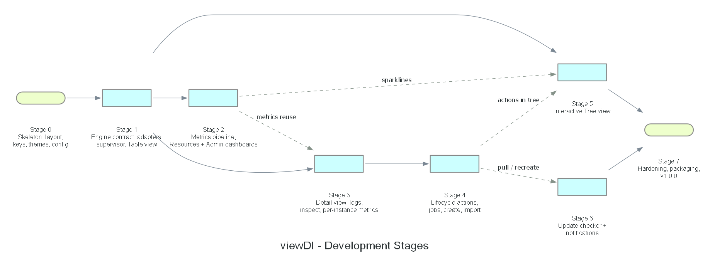

# viewDI — Phase 2: Development Plan

Status: **Validated (Phase 2)** · Date: 2026-10-28

Companion document: `05-quality-plan.md` (testing, resilience, rendering performance).

## 1. Roadmap

Solid arrows are hard dependencies; dashed arrows mean "reuses components from".
After Stage 1, Stages 2, 3 and 5 can start in parallel, with two exceptions inside
Stage 5: task 5 (live sparklines in the inspector) needs the Stage 2 metrics pipeline and
sparkline component, and task 7 (lifecycle actions in the tree) needs Stage 4. Stage 5 can
build everything else first and is only *done* once Stages 2 and 4 are merged. The order
below is the recommended serial order for a single developer, which satisfies both.

| Stage | Theme | Relative size | Release tag |
|---|---|---|---|
| 0 | Skeleton, layout, keyboard navigation, theme engine, config | M | `v0.1.0` |
| 1 | Engine contract, Docker + Incus adapters, supervisor, Table view | L | `v0.2.0` |
| 2 | Metrics pipeline, Resources dashboard, Admin dashboard, alerts | L | `v0.3.0` |
| 3 | Detail view: Overview, Logs, Inspect, Network, Volumes, Resources | L | `v0.4.0` |
| 4 | Lifecycle actions, job runner, create forms, import | L | `v0.5.0` |
| 5 | Interactive Tree view | M | `v0.6.0` |
| 6 | Update checker and notifications | M | `v0.7.0` |
| 7 | Hardening, packaging, docs, `v1.0.0` | M | `v1.0.0` |

Sizes: S ≈ a few sessions, M ≈ one to two weeks part-time, L ≈ two to three weeks part-time.

## 2. Working Agreement (applies to every stage)

1. **Validation gate:** before coding a stage, its task list below is reviewed and
   confirmed (or adjusted) by the user.
2. **Branch per stage:** `stage/N-short-name`, Conventional Commits, merged to `master`
   when the Definition of Done is met; tag the release.
3. **Mock-first:** every UI feature is demoable with `viewdi --mock` before it's wired
   to a real daemon. The fake engine grows with each stage.
4. **Definition of Done (global):**
   - `make lint test` green with `-race`; `goleak` clean.
   - New UI states covered by golden tests (80×24 and 120×40, at least two themes).
   - Every new failure path has a chaos scenario (see quality plan §3).
   - Performance budgets still met (`make bench`).
   - Diagrams regenerated if architecture changed; `CLAUDE.md` and docs updated.
   - A short `vhs` tape recorded for the stage demo (`docs/demos/stage-N.tape`).

---

## Stage 0 — Skeleton, Layout, Keyboard Navigation, Theme Engine

**Goal:** a polished, empty shell. Every later stage only adds content to it.

Tasks:
1. Repository bootstrap (git repo already initialised on `master`): `go.mod` (pin Bubble Tea/Bubbles/Lip Gloss v2),
   `Makefile`, `.golangci.yml`, `.editorconfig`, CI workflow (lint, test, golden).
2. `cmd/viewdi`: flag parsing (`--mock[=<scenario>]`, `--read-only`, `--debug`,
   `--trace[=<file>]`, `--pprof=<addr>`, `--theme`, `--refresh`; `--docker-host` and
   `--incus-socket` are parsed here and consumed in Stage 1), signal handling (SIGTERM/SIGINT clean exit, SIGTSTP/SIGCONT).
3. `internal/config`: XDG paths, `config.toml` load + validation + defaults, `state.json`
   atomic read/write, warnings surfaced as messages instead of startup failures.
4. `internal/ui/theme`: semantic token schema, TOML loader, embedded built-ins
   (Everforest dark/light, Dracula, Catppuccin Mocha/Latte, Monokai, Gruvbox, Nord,
   Tokyo Night), style cache, color profile degradation, user themes override built-ins.
5. `internal/ui/keys`: layered key map (modal → component → view → global) with help
   text, `keys.toml` overrides, conflict detection enforcing the reserved global and
   instance-action keys (`03-mockups.md`, Key map).
6. `internal/app`: root model, router for views `1`–`6` (placeholders), focus manager,
   modal stack, toast queue, banner slot.
7. Components: header (engine status placeholders + badge slot), tab bar, status/key-hint
   bar, help overlay (`?`), theme picker with live preview (`T`), confirm modal, toast.
8. Layout engine: responsive breakpoints (≥120 cols two-column layouts, 80–119 stacked,
   <80×24 "terminal too small" screen), resize handling.
9. Debug overlay (`ctrl+d`, only with `--debug`): FPS, frame time, message rate, goroutines.

Acceptance criteria:
- `viewdi --mock` starts in < 150 ms, navigates all six placeholder views with keys only.
- Theme switch is instant and persists in `state.json`; invalid theme file shows a
  warning toast and falls back to the default.
- Resizing never garbles the screen; tiny terminal shows the "too small" screen.

Risks: Bubble Tea v2 API churn → pin versions; ntcharts v2 compatibility → decide here
(adopt or write in-house sparkline in Stage 2). **Decided:** in-house sparkline/gauge, see
`01-research.md` §1.2.

Delivered notes (2026-10-28): demo recorded with `vhs` (`docs/demos/stage-0.tape` →
`docs/demos/stage-0.gif`); the CI `diagrams` job checks that `generate.py` runs instead of byte-comparing
PNGs (see `05-quality-plan.md` §1.4).

---

## Stage 1 — Engine Contract, Adapters, Supervisor, Table View

**Goal:** real data from both daemons in a fast, filterable table, with graceful
degradation when either daemon is missing.

Validated by the user on 2026-10-29 (task list unchanged).

Tasks:
1. `internal/engine`: domain types (`Instance`, `Network`, `Volume`, `Event`, `EngineInfo`,
   `Capabilities`, `Extra` per engine) and the `Engine` interface (read-only subset now:
   `Ping`, `Info`, `ListInstances`, `Inspect`, `Events`, `Networks`, `Volumes`).
2. **Engine contract test suite** (`internal/engine/enginetest`): one shared suite that
   any adapter must pass.
3. `provider/fake`: in-memory engine with a scenario DSL (add/remove/state-change,
   latency, hang, disconnect, permission error) — passes the contract suite.
4. `provider/docker`: socket discovery (flag → `DOCKER_HOST` → config → rootless →
   rootful), API version negotiation, list/inspect/networks/volumes, events stream,
   mapping to domain types.
5. `provider/incus`: socket discovery (flag → `INCUS_SOCKET` → config → `unix.socket` →
   `unix.socket.user`), projects, `GetInstancesFull`, networks/storage/profiles, events
   WebSocket, capability detection for restricted sockets.
6. Fixture recorder dev tool (`scripts/` or `cmd/fixturerec`, build-tagged) that captures
   real API responses into `testdata/` with sanitisation of hostnames/IPs/secrets.
7. `internal/supervisor`: state machine (Connecting/Connected/Degraded/Unavailable),
   exponential backoff with jitter, ping watchdog, periodic full resync (30 s),
   permission hint generation.
8. `internal/store`: instance index keyed by stable IDs, event application, snapshots.
9. Message pump: re-arming `tea.Cmd`, coalescing of bursty event streams.
10. Table view: columns (engine, name, kind, state, image, uptime; CPU/MEM placeholders),
    sort by any column (`o` cycle column, `O` reverse), `/` fuzzy filter, `e` engine filter, `P` Incus project selector,
    virtualised rendering, selection preserved across refreshes.
11. Header shows real engine status; reconnect banner; red "Unavailable" card with hint.

Acceptance criteria:
- With both daemons: list matches `docker ps -a` + `incus list` (all projects selectable).
- Stopping `incusd` while running: banner within ≤ 5 s, Docker data unaffected, automatic
  recovery after restart without user action.
- User not in `incus-admin`/`docker` group: app starts, shows actionable hint.
- 500 fake instances: table scroll stays within the frame-time budget.

Delivered notes (2026-10-29):
- The upstream Incus client stores the request context in the shared client value
  (`WithContext` mutates it) and dispatches each event on its own goroutine. The adapter
  therefore derives a fresh client per call (`UseProject` + `WithContext`) and reads the
  events websocket itself, which keeps events in order.
- The Docker list endpoint has no start time: uptimes come from bounded (8 concurrent),
  cached inspect calls, invalidated by events and after 5 minutes.
- Fixture sets for Docker API v1.52 and Incus 6.0.5 are **hand-written** from the API
  references (`"recorded": false` in their `index.json`) because no daemon was available;
  `make fixtures ENGINE=docker|incus` (`cmd/fixturerec`, build tag `fixturerec`) records
  sanitised replacements through a recording proxy. The acceptance checks against real
  daemons (`docker ps -a` + `incus list`, stopping `incusd`, group membership) remain to
  be run manually; the same behaviour is covered with the fake engine (supervisor tests
  and `internal/app/chaos_test.go`).
- The scenario DSL is the Go builder only (the optional YAML form is not implemented);
  `logflood` and `offline` reuse the homelab world until Stages 3 and 6.
- Measured: one key press plus a full frame with 500 instances ≈ 2 ms at 120×40.
- `internal/clock` (injectable clock with a fake) and `internal/fixtures` (fixture
  server, recorder, sanitiser) were added to the package layout.
- Demo recorded with `vhs` (`docs/demos/stage-1.tape` → `docs/demos/stage-1.gif`); merged
  in blokxz/viewDI#1 and tagged `v0.2.0`. Still open, needing a host with real daemons:
  recorded fixtures (`make fixtures`) and the three real-daemon acceptance checks.

---

## Stage 2 — Metrics Pipeline, Resources Dashboard, Admin Dashboard

**Goal:** accurate global and per-engine real-time consumption at a low host cost.

Validated by the user on 2026-10-29, with two adjustments: (a) the engine contract gains a
`Stats` capability (cumulative per-instance counters) implemented by both adapters and the
fake, whose scenario DSL gains synthetic metric profiles; (b) the ±5 % accuracy and < 2 %
CPU criteria are verified on a real host — in CI they are covered with the fake engine,
cgroup fixtures and benchmarks.

Tasks:
1. `internal/metrics/cgroup`: cgroup v2 reader (`cpu.stat`, `memory.current`,
   `memory.stat`, `io.stat`), path resolution via `/proc/<init-pid>/cgroup` with layout
   fallbacks: Docker systemd/cgroupfs drivers, rootless Docker under
   `user@<uid>.service`, Incus `lxc.payload.<name>` (default project) and
   `lxc.payload.<project>_<name>` (other projects) — see `01-research.md` §3.2.
   Incus VMs are excluded (API-only metrics; guest figures require `incus-agent`).
2. Network counters: Incus instance state / `/1.0/metrics`; Docker via one-shot stats
   (low rate) or `/proc/<pid>/net/dev` of the container's init PID when readable.
3. OpenMetrics parser for Incus `/1.0/metrics` (fuzzed).
4. Rate computation (counters → per-second rates, counter reset/wrap handling), per-
   instance ring buffers (default 5 min at 1 s), per-engine aggregation.
5. Sampling scheduler: adaptive rate (visible/foreground vs hidden/unfocused), fallback
   chain (cgroup → engine API) per instance, sampling health indicator.
6. Components: sparkline (in-house, see `01-research.md` §1.2), gauge bar, mini-table "Top consumers".
7. Resources dashboard (`2`): per-engine panels (CPU, RAM, NET, DISK), top consumers
   (sortable with `o`/`O`),
   refresh-rate control (`+`/`-`), stale marking for degraded engines.
8. Alert engine: rules (unhealthy healthcheck, restart loop, memory > threshold, CPU
   sustained > threshold, engine degraded/unavailable), dedup + auto-resolve,
   thresholds in `config.toml`.
9. Admin dashboard (`1`): daemon cards (version, counts, storage driver, cgroup version,
   socket type), alerts panel, recent events feed, shortcuts panel.
10. Table view gains live CPU% / MEM columns.

Acceptance criteria:
- Dashboard totals within ±5 % of `docker stats` / `incus info` on a reference host.
- With 50 running containers at 1 Hz: viewDI CPU < 2 % of one core (see budgets).
- Alerts appear and resolve automatically; no duplicate alerts on reconnect.

Delivered notes (2026-10-29):
- `engine.Stats` reads cumulative counters for many instances in one call: Docker one-shot
  stats (memory without the inactive page cache, like `docker stats`), Incus one
  `/1.0/metrics` request (fuzzed OpenMetrics parser) with an instance-state fallback for
  restricted sockets, synthetic profiles (flat / sine / spike) in the fake.
- Sampler: one pass per interval over every running instance of every connected engine;
  cgroup v2 first (path from `/proc/<pid>/cgroup`, then the known layouts; a failing
  cgroup moves the instance to the API path for 60 s), one `Stats` batch per engine for
  the rest. Interval: the refresh rate while Admin, Resources or Table is visible and the
  terminal focused, 5 s otherwise; `+`/`-` step 250 ms–2 s. Measured: a 50-container
  cgroup pass ≈ 2.5 ms.
- History: 300 points per instance and per engine (5 min at 1 s); passes are lossy.
- Alerts (`internal/alerts`) are evaluated in the UI goroutine on every change and on
  the render clock; alerts of a disconnected engine are frozen until it reconnects.
- The ±5 % accuracy and < 2 % CPU criteria still need a real host; CI covers them with
  the fake engine, cgroup fixtures and benchmarks.
- Demo: `docs/demos/stage-2.tape` → `docs/demos/stage-2.gif`.

---

## Stage 3 — Detail View

**Goal:** everything about one instance, with live logs and metrics.

Validated by the user on 2026-10-29, with two adjustments: (a) log streaming and the
per-instance stats stream join the engine contract (`Logs`, `WatchStats`, plus
`InspectRaw` for the Inspect tab), implemented together by both adapters and the fake,
whose log generator brings the `logflood` scenario to life; (b) logs from real daemons
are checked on a real host — CI covers them with fixtures and the fake engine.

Tasks:
1. Detail view container with tab bar (Overview, Logs, Inspect, Network, Volumes,
   Resources), breadcrumb, persistent last-used tab per engine.
2. Registry `Subscribe`/`Unsubscribe` with cancellable contexts; goroutine leak tests.
3. Overview tab: description (OCI labels `org.opencontainers.image.*`, Incus
   `image.description`/`user.*`), image, command, restart policy, health, compose/project,
   labels, env with secret masking (`v` to reveal one value).
4. Logs tab: Docker follow + `stdcopy` demux; Incus console log polling / attach and log
   files; ring buffer (10 k lines, configurable); pause with "+N new" counter; regex
   filter with match highlighting (`ctrl+n`/`ctrl+p` next/prev match); stdout/stderr stream
   cycle (`S`); wrap; timestamps; jump
   top/bottom; **terminal-escape sanitisation**; per-line length cap.
5. Inspect tab: collapsible structured view of the raw inspect document (JSON → tree),
   search inside, copy path (OSC 52 clipboard).
6. Network tab: interfaces, IPs, MAC, ports, attached networks, per-NIC rates (Incus).
7. Volumes tab: mounts/devices, type (bind/volume/tmpfs/disk device), RO/RW, usage when
   available.
8. Resources tab: per-instance stream (Docker `stats?stream=1`, Incus state 1 s), larger
   charts, limits overlay (CPU quota, memory limit), PIDs, time-window control.
9. Instance removed while open → tab shows "instance removed" state instead of erroring.

Acceptance criteria:
- 1 000 log lines/s for 60 s: UI stays responsive, memory bounded, no dropped-UI frames
  beyond budget, drop counter visible when filtering can't keep up.
- Opening/closing detail 100 times leaves zero extra goroutines.

Delivered notes (2026-10-29):
- Engine contract: `InspectRaw`, `Logs(opts)` (tail, since, follow; lines capped at 8 KiB)
  and `WatchStats(interval)` (samples with per-interface counters and, on Incus, per-disk
  usage); the contract suite checks all three on every backend. `engine.Stream[T]`
  generalises the event feed.
- Docker: one inspect (TTY or not), then `logs?follow&timestamps` demultiplexed in-house
  (frames need not be line-aligned; daemon error frames end the stream);
  `stats?stream=true` throttled to the interval. Incus: the console ring buffer (stdout)
  and `lxc.log`/`qemu.log` (system) are polled every second and diffed (the console has
  no follow endpoint); instance state is polled for stats. Fixture sets and the recorder
  gained these endpoints (multiplexed frames are sanitised frame by frame).
- `internal/streams`: one subscription per open detail; logs, stats and inspect each run
  in their own goroutine with backoff (1 s → 30 s), resume after a failure from the last
  timestamp without duplicates, stop on not-found/permission, and wait for `Refresh`
  (sent by the app when the instance or its engine changes) after a clean end. Lines are
  sanitised there (`internal/textsafe`, fuzzed), at most 5 000 lines wait for the UI
  (oldest dropped and counted), and batches are at most 10 per second.
- UI: `logview` (bounded ring, default 10 000 lines, `[logs] buffer_lines`), `jsontree`
  (ordered, collapsible, search, jq-style path copied with OSC 52, 50 000-node cap,
  fuzzed), `secret` (masking for env values and secret-looking keys, also inside the
  Inspect tree), multi-row charts. The last tab is remembered per engine in state.json.
- Measured (`TestLogFloodStaysResponsive`, `VIEWDI_LONG=1` for 60 s at 1 000 lines/s):
  worst key latency 40 ms, buffer at its cap, heap 3.6 MB; 100 open/close cycles leave
  no subscription or goroutine (`TestDetailOpenClose100`, goleak).
- Still to check on a real host: Docker TTY containers, Incus VM console logs, and
  per-NIC rates against `incus info`.
- Demo: `docs/demos/stage-3.tape` → `docs/demos/stage-3.gif`.

---

## Stage 4 — Lifecycle Actions

**Goal:** safe, observable management operations.

Validated by the user on 2026-10-29, with three adjustments: (a) delivered in two PRs —
**4a** (tasks 1–4, 7, 8: actions, jobs, delete, read-only, optimistic UI; `v0.5.0`) and
**4b** (tasks 5–6: create forms and import; `v0.6.0`); (b) destructive operations are
covered in CI by the fake engine and hand-written fixtures, and checked against real
daemons on a real host; (c) safer defaults: stop waits 10 s before killing
(configurable), delete never removes named volumes, Incus stop-then-delete is off unless
ticked in the dialog.

Tasks:
1. Extend `Engine` with mutating capabilities; contract tests for each (fake + fixtures).
2. `internal/jobs`: job registry, progress reporting (Incus operations, Docker pull/load
   progress JSON), cancellation, Jobs view (`5`) with history.
3. Start (`s`) / stop with timeout (`x`) / restart (`R`) / pause-freeze ↔ unpause toggle
   (`F`); multi-select in Table
   (`space` to mark, action applies to all marked).
4. Delete with confirm modal (type-the-name for running or with volumes); options:
   force, remove anonymous volumes (Docker), stop-then-delete (Incus).
5. Create forms (form component with validation):
   - Docker: image (with local image autocomplete), name, ports, env, volumes, network,
     restart policy, labels; optional pull.
   - Incus: image source (local alias, remote `images:` with search), name, type
     container/VM, profiles, CPU/memory limits, network, storage pool.
6. Import: file picker component; Docker image tarball (`load`), rootfs tarball
   (`import`), Incus instance backup, Incus image; progress + resulting instance/image.
7. `--read-only` and restricted-capability enforcement: actions hidden/disabled with a
   reason in the help bar.
8. Optimistic UI: action marks the row "pending"; the authoritative state comes from the
   event stream; timeout → error toast and resync.

Acceptance criteria:
- Every action is reversible or confirmed; no destructive action without a modal.
- Daemon dies mid-operation → job marked failed with a clear message, UI unaffected.

---

## Stage 5 — Interactive Tree View

**Goal:** the navigable tree from `03-mockups.md` M4 and `02-architecture.md` §5.

Tasks:
1. Generic `tree` component: node model with stable IDs, flattened visible-node list,
   virtualised rendering, guides (`├── └── │`), expand/collapse state, cursor.
2. Navigation keys (`↑↓←→`, `hjkl`, `[` `]`, `space`, `*`, `-`, Home/End, PgUp/PgDn).
3. Tree builders per grouping mode: network, Incus project, Compose project, engine-only;
   leaves for ports, mounts, extra networks, devices.
4. Multi-network occurrences (`⇄`) and `J` jump; breadcrumb.
5. Inspector component: renderers per node type (engine, network, instance, leaf),
   debounced, snapshot-only reads, live sparklines from Stage 2.
6. Filter mode keeping ancestors; match count; `ctrl+n`/`ctrl+p` next/prev match.
7. Lifecycle actions on the focused instance (reuse Stage 4).
8. Expansion state persistence per grouping mode; ASCII icon fallback.

Acceptance criteria:
- Holding `↓` over 1 000 nodes scrolls smoothly within the frame budget.
- Cursor and expansion survive live state changes and reconnects.

---

## Stage 6 — Update Checker and Notifications

**Goal:** `01-research.md` §3.4 implemented end to end.

Tasks:
1. `internal/updates`: scheduler (startup delay, intervals, manual trigger), result
   diffing vs last seen, cache in `~/.cache/viewDI/updates.json`.
2. Engine sources: package manager detectors (apt, dnf, pacman, zypper — parsed with
   `LC_ALL=C`, fuzzed parsers), GitHub releases with ETag cache, Incus channel detection.
3. Image sources: Docker `DistributionInspect` digest comparison (bounded concurrency,
   per-reference cache), Incus simplestreams alias fingerprint comparison.
4. Notifier: header badge, admin alerts, Table/Tree `⬆` markers, toast on new results,
   D-Bus desktop notifications (opt-in, `notify_min_level`), `notify-send` fallback.
5. Updates view (`6`): engines and images tables, actions (`p` pull, `c` recreate,
   `f` refresh, `z` snooze, `I` ignore version, `enter` open release notes via `xdg-open`).
6. Recreate flow for standalone Docker containers (config diff preview + confirm);
   Compose hint for Compose-managed containers.

Acceptance criteria:
- With `updates.enabled = false` a network-traffic test proves zero outbound requests.
- Offline host: one "last check failed" message, no repeated toasts, no UI stalls.

---

## Stage 7 — Hardening, Packaging, v1.0.0

Tasks: full chaos suite run on real daemons; fuzzing campaign; performance profiling
pass; accessibility pass (monochrome/no-color mode, `NO_COLOR`); man page and `--help`;
`goreleaser` builds (static binaries amd64/arm64, `.deb`, `.rpm`, tarball; AUR PKGBUILD
optional); README with demo GIFs (`vhs`); `CHANGELOG.md`; security review of the socket
and subprocess handling.

---

## 3. Risk Register

| Risk | Impact | Mitigation |
|---|---|---|
| Bubble Tea v2 / Bubbles v2 breaking changes | Rework | Pin versions; upgrade only between stages |
| moby client v29+ API breaks (option structs) | Adapter rework | Adapter isolates SDK; contract suite catches regressions |
| cgroup layout differences (cgroupfs vs systemd driver, nested) | Wrong metrics | Path resolver with fallbacks + per-instance fallback to engine API |
| Incus restricted socket lacks features | Partial UI | Capability detection; disable with explanation |
| Log floods / hostile log content | Freeze, terminal injection | Ring buffer, coalescing, escape sanitisation, line cap |
| GitHub rate limits for update checks | Missing results | ETag cache, long intervals, package-manager-first |
| Scope creep (Compose management, remote hosts, Kubernetes) | Delays | Backlog "post-1.0"; not in stages above |

## 4. Post-1.0 Backlog (out of scope for now)

Remote Incus servers (HTTPS + TLS certs) and remote Docker contexts · `exec`/shell into an
instance (embedded PTY) · snapshots management (Incus) · Compose stack actions ·
Podman via Docker-compatible socket · export metrics/history · plugin hooks.
