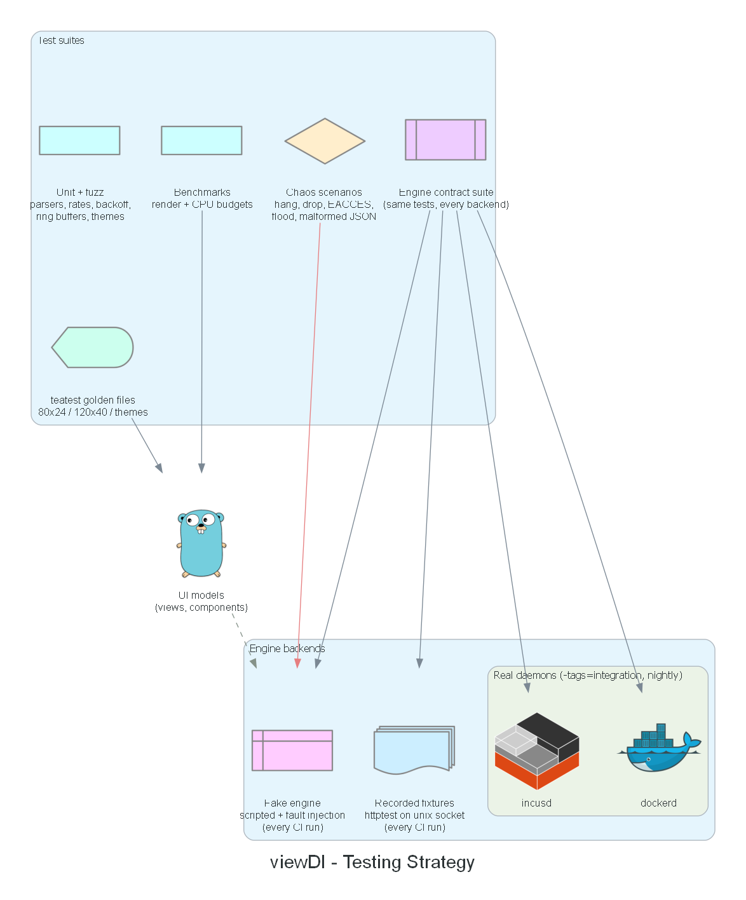

# viewDI — Phase 2: Quality Plan

Status: **Validated (Phase 2)** · Date: 2026-10-28

Covers the three cross-cutting plans: testing strategy with daemon mocking, bug hunting
and resilience, and rendering/FPS optimisation. Applies to every stage of
`04-development-plan.md`.

---

## 1. Testing Strategy

### 1.1 Layers

| Layer | What | Tooling | Runs |
|---|---|---|---|
| Unit | Rate calc, aggregation, backoff, ring buffers, theme/config parsing, alert rules, version comparison, tree flattening | `testing`, table-driven | every CI run |
| Fuzz | Parsers fed by external input: OpenMetrics, cgroup files, package-manager output, log demux, escape sanitiser, theme/config TOML | Go native fuzzing (`go test -fuzz`) | short run in CI (30 s each), long runs nightly / Stage 7 |
| Engine contract | One shared suite (`internal/engine/enginetest`) every backend must pass: list, inspect, events ordering, lifecycle semantics, error classification | custom suite | fake + fixtures every run; real daemons nightly |
| Adapter fixtures | Docker/Incus adapters against **recorded API responses** served by `httptest` on a temporary **Unix socket** (exercises the real SDKs end to end) | `httptest`, `net.Listen("unix", …)` | every CI run |
| UI golden | Full app driven by the fake engine; output compared with golden files at 80×24 and 120×40, Everforest + Catppuccin Latte (dark + light coverage) | `teatest` v2 | every CI run |
| Chaos | Scripted failure scenarios (see §3.3) asserting UI stays responsive and shows the right banners | fake engine fault injection | every CI run |
| Integration | Real `dockerd` + `incusd`: create/start/stop/delete, logs, stats, events, permission errors | `-tags=integration` | nightly / manual (`make test-integration`) |
| Benchmarks | Render cost per view, metrics pipeline throughput, log ingestion | `testing.B`, `benchstat` | every CI run with regression threshold |

### 1.2 Daemon mocking — the fake engine

`provider/fake` is a first-class adapter, not a test stub:
- **State:** in-memory instances/networks/volumes; mutations emit the same events a real
  daemon would (verified by the contract suite, so the fake can't drift from reality).
- **Scenario DSL** (Go builder API + optional YAML for `--mock=<scenario>`):
  `At(2s).Start("web-api")`, `At(5s).Hang(Incus, 10s)`, `Every(1s).LogBurst("web", 500)`,
  `At(3s).Fail(Docker, EACCES)`, `At(4s).Disconnect(Incus)`, `Metrics(Sine/Spike/Flat)`.
- **Deterministic time:** a `Clock` interface injected everywhere (supervisor, sampler,
  jobs, toasts). Tests use a fake clock; no `time.Sleep` in tests.
- **Deterministic IDs and randomness:** seeded RNG; backoff jitter seeded in tests.
- **Bundled scenarios:** `homelab` (default demo), `large` (500 instances, 1 000 tree
  nodes), `chaos` (rotating failures), `logflood`, `offline` (no network for updates).

### 1.3 Fixture recording

A build-tagged dev tool records real responses from both daemons into
`testdata/fixtures/{docker,incus}/<api-version>/…`, sanitising hostnames, IPs, MACs,
env values and tokens. Fixtures are versioned by API version so the adapters are
tested against several daemon releases.

### 1.4 CI pipeline (GitHub Actions or equivalent)

1. `lint` — golangci-lint, gofumpt check, `go vet`, `go mod tidy` diff.
2. `test` — `go test -race -shuffle=on ./...` + goleak.
3. `golden` — UI golden tests (fail with a diff artifact).
4. `fuzz-short` — each fuzz target for 30 s.
5. `bench` — compare with `master` via `benchstat`; fail on > 15 % regression.
6. `diagrams` — check that `generate.py` still runs. PNGs are not byte-compared: Graphviz
   output differs between builds, so an exact diff would fail on every runner.
7. Nightly: `integration` on a runner with Docker + Incus (Ubuntu + Zabbly packages),
   long fuzzing.

Coverage targets: ≥ 80 % for `engine`, `store`, `metrics`, `supervisor`, `updates`,
`config`; UI covered by golden tests rather than line coverage.

---

## 2. Bug Hunting

- **Debug log** (`--debug`): structured `slog` to `~/.local/state/viewDI/viewdi.log`,
  rotated, includes engine, request, duration, error class. Never written to the terminal.
- **Message trace** (`--trace[=<file>]`, default `~/.local/state/viewDI/trace-<ts>.log`):
  every `tea.Msg` type + timestamp written to the trace file;
  replayable against the UI in tests to reproduce bugs deterministically.
- **Debug overlay** (`ctrl+d` with `--debug`): FPS, frame time p50/p99, messages/s by
  type, channel depths, goroutine count, open streams, supervisor states.
- **pprof** (`--pprof=127.0.0.1:6060`, localhost only) for CPU/heap/goroutine profiles.
- **Crash report:** UI panic → terminal restored, stack + last 200 trace entries saved to
  `~/.local/state/viewDI/crash-<ts>.log`, path printed on exit.
- **Bug template** in the repo: version, engines + versions, socket type, terminal,
  `$TERM`, scenario/trace file.
- **Bug → regression test rule:** each fixed bug gets a fake-engine scenario or fixture
  test reproducing it.

---

## 3. Resilience Plan

### 3.1 Principles
1. The UI goroutine never waits on I/O. Violations are caught by a CI test that runs the
   app against a fake engine whose every call hangs forever and asserts that key presses
   are still processed within 50 ms.
2. Every call has a deadline; every stream has a watchdog.
3. Engines fail independently; partial data is better than no data (stale marking).
4. Every external input is untrusted: sizes capped, content sanitised, parsers fuzzed.

### 3.2 Failure-mode catalogue

| # | Failure | Detection | Behaviour |
|---|---|---|---|
| F1 | Daemon stopped (ECONNREFUSED, or socket removed → ENOENT after a previous connection) | request error | Degraded → backoff reconnect; banner with countdown; `ctrl+r` retries now. ENOENT before any connection = not installed/not started → Unavailable with socket-path hint |
| F2 | Socket accepts but never responds (hung daemon) | per-request timeout (5 s), ping watchdog | Same as F1; in-flight requests cancelled; no goroutine pile-up (one in-flight ping max) |
| F3 | Event stream silently stalls | no events + ping ok → periodic resync (30 s) detects drift; Incus WebSocket ping/pong | Resubscribe stream; resync list |
| F4 | Daemon restarts mid-stream | stream EOF | Reconnect, full resync, reopen subscribed log/stat streams transparently (log tab shows a "reconnected" marker line) |
| F5 | Permission denied / revoked | EACCES, HTTP 403 (from any state, including Connected) | Unavailable state with group hint; slow re-probe (60 s) |
| F6 | Slow daemon (large hosts) | latency metrics | Requests stay bounded; listing paginated by project; spinner instead of freeze |
| F7 | Malformed / unexpected API data | decode errors | Instance shown with "?" fields + debug log; never crash the adapter |
| F8 | Log flood | ingestion rate | Ring buffer, render coalescing (≤ 10 Hz), "dropped N lines" indicator when filtering lags |
| F9 | Hostile log content (escape sequences, huge lines, invalid UTF-8) | sanitiser | Strip non-SGR escapes, render SGR via safe parser or strip (configurable), cap line at 16 KiB, replace invalid UTF-8 |
| F10 | Instance removed while viewed | event / 404 | Detail shows "removed" state; actions disabled |
| F11 | Long operation stuck (Incus op, Docker pull) | job timeout / user cancel | Cancel via context; Incus operation cancel; job marked failed |
| F12 | Provider goroutine panic | `recover` wrapper | Error reported, supervisor restarts the provider; UI keeps running |
| F13 | UI panic | Bubble Tea recover | Terminal restored, crash log written |
| F14 | Terminal resized to tiny / suspended (SIGTSTP) / closed (SIGHUP) | tea messages / signals | "Too small" screen; pause sampling while suspended; clean shutdown cancelling all contexts |
| F15 | Invalid config / theme / state file | load errors | Defaults + warning toast; corrupt `state.json` renamed to `.bak` |
| F16 | Disk full / read-only home when writing state | write error | Toast once; continue without persisting |
| F17 | cgroup files unreadable / unexpected layout | read error | Per-instance fallback to engine API; sampling health indicator |
| F18 | Update checker offline / rate-limited | HTTP errors, 403 rate limit | "Last check failed" + next retry time; no repeated toasts |

### 3.3 Chaos scenarios (automated)

Each failure row F1–F18 that can be simulated has a fake-engine scenario plus an
assertion set: (a) UI responds to input within 50 ms throughout, (b) expected banner/state
appears within N seconds, (c) recovery without user action where applicable, (d) no
goroutine leaks at the end. Before v1.0, the same scenarios are run manually against real
daemons (`systemctl stop/kill -STOP incus`, `chmod` on sockets, `docker` restart).

---

## 4. Rendering and FPS Optimisation

### 4.1 Performance budgets (reference host: Ryzen 5 5600X, 120×40 terminal)

| Metric | Budget |
|---|---|
| Startup to first frame | < 150 ms |
| Idle CPU, 50 running instances, 1 Hz metrics | < 2 % of one core |
| Frame render time (p99) | < 8 ms at 120×40; < 16 ms at 300×80 |
| Input latency (key → frame) | < 50 ms under log flood |
| RSS memory, 100 instances + 2 log tabs (10 k lines each) | < 80 MB |
| Metric streams open | 0 per-instance streams unless a detail/Resources tab is open |

### 4.2 Techniques

1. **Decouple sampling from rendering.** Samplers write to the store at their own rate; the
   UI re-renders on a tick only when a dirty flag is set.
2. **Throttle by visibility.** Metrics UI tick default 1 Hz (configurable 0.5–4 Hz); hidden
   views do not render; unfocused terminal (focus reporting) or suspended → sampling at
   5 s; detail streams closed when the tab closes.
3. **Coalesce bursts.** Events within 50 ms batch into one message; logs redraw ≤ 10 Hz;
   metric samples are "latest wins".
4. **Cache renders.** Components keep their last rendered string keyed by
   `(data version, width, height, theme version)`; unchanged panels are reused verbatim.
5. **Virtualise.** Table, tree and log viewer render only visible rows; tree keeps a
   flattened visible-node slice rebuilt only on expand/collapse/filter/data change.
6. **Cheap styling.** Styles built once per theme change; rows rendered by concatenating
   pre-rendered segments; no per-cell style construction.
7. **Downsample charts to width.** Ring buffers hold full resolution; sparklines take
   min/max/avg buckets for the visible width only.
8. **Renderer cap.** Bubble Tea renderer FPS limited (default 30) — redraws never exceed it
   even under event storms.
9. **Bound concurrency.** One sampler pass per tick for all cgroup reads; max concurrent
   API requests per engine (default 8); registry digest checks max 4.
10. **Measure continuously.** Benchmarks per view with fake `large` scenario, `benchstat`
    in CI, pprof sessions before each release, debug overlay showing live frame times.
